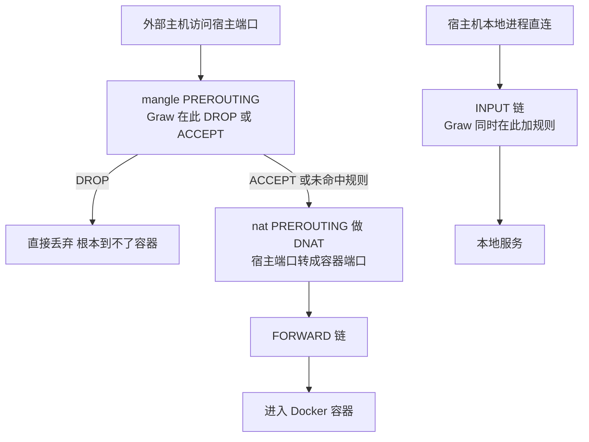
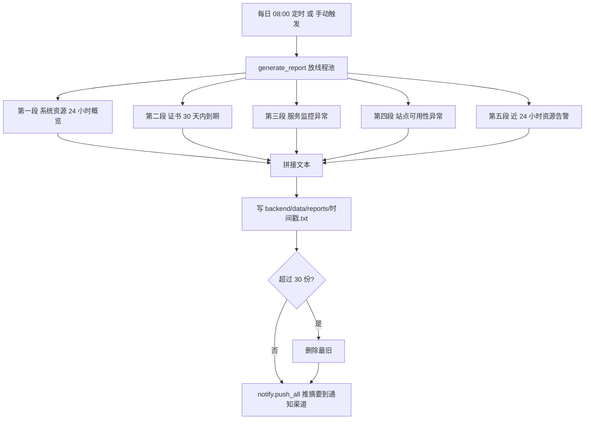
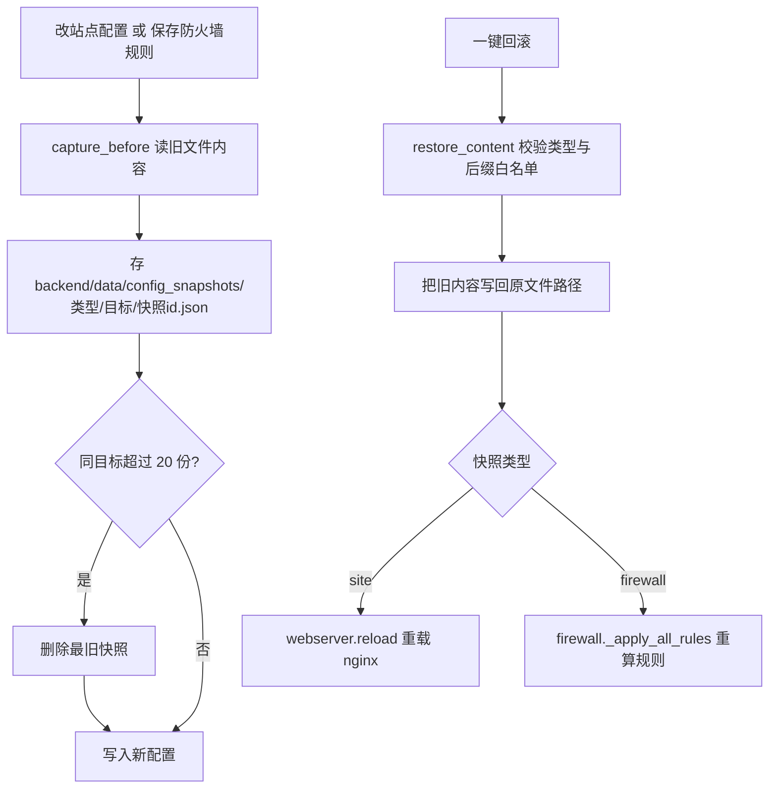
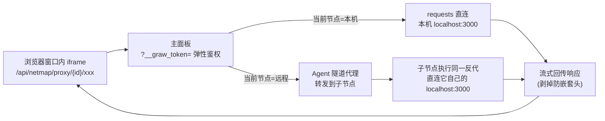
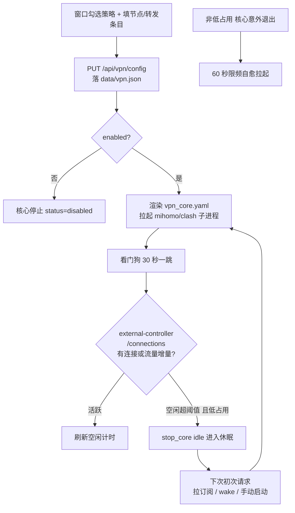
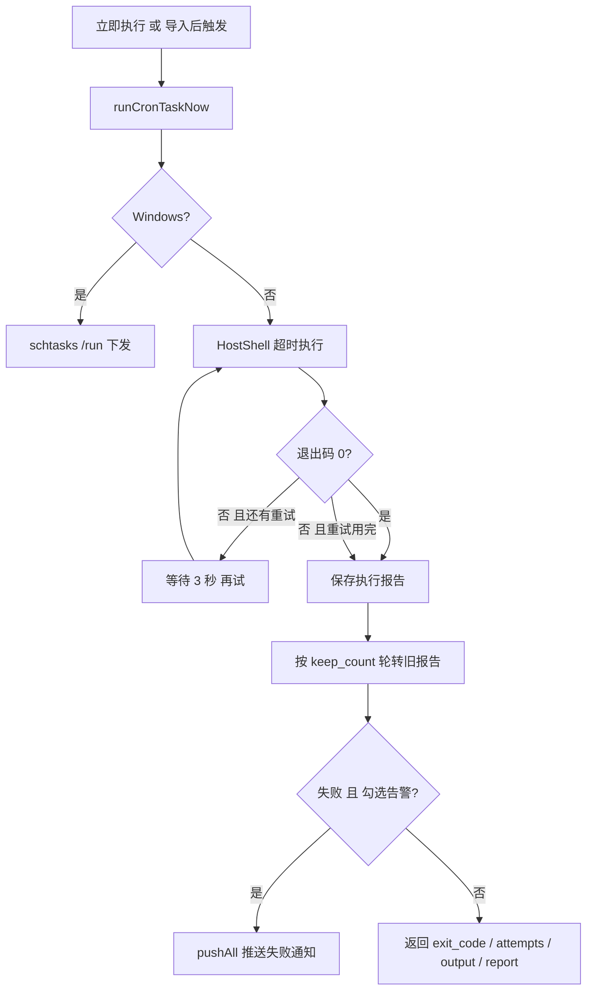

# 11 安全防护与运维工具

> 大白话主线：这一篇把面板里「安全 + 运维」那一摞工具串起来讲——防火墙怎么真正拦住 Docker 暴露的端口、保护中心怎么提醒你别把数据库装丢、SSH 端口转发怎么让本地工具直连远程库、镜像漏洞扫描怎么在本地比对、每日巡检报告怎么自动生成、慢查询怎么查、多台机器怎么批量操作，以及改坏了配置怎么一键回滚；还有 VPN 转发策略怎么把一堆节点变成 Clash 订阅、又怎么「低占用」地托管核心。
> 它们共同的特点是：**都跟「主机安全」和「事后可救」有关**——要么提前拦住，要么出事后能查、能恢复。

---

## 一、防火墙与 Docker 发布端口防护

### 1. 是什么、解决什么问题

防火墙模块（`/api/firewall`，ADMIN）负责按「端口规则」和「IP 规则」在宿主机上落 iptables/netsh 规则，并提供「列出监听端口 / 默认屏蔽未放行端口 / 重放规则」这些操作。

它要解决的一个经典坑是：**Docker 发布端口（`-p 8080:80`）用普通 `INPUT DROP` 拦不住。**

原因在于数据包路径：外部流量进宿主后，先在 `nat PREROUTING` 被 DNAT 成容器端口，然后走 `FORWARD` 链进入容器——**根本不经过 `INPUT`**。所以只写 `INPUT DROP`，那个端口照样能从公网访问。要想真拦住，必须在 **`mangle PREROUTING`（DNAT 之前）** 就把包丢掉。

### 2. 运行逻辑

每条端口规则落两条规则，都用 `-I` 插到链顶（保证能压过此前可能存在的更高优先规则）：

- **放行（allow）**：`iptables -I INPUT -p tcp --dport <端口> -j ACCEPT` + `iptables -t mangle -I PREROUTING -p tcp --dport <端口> -j ACCEPT`。
- **拒绝（deny）**：`iptables -I INPUT ... -j DROP` + `iptables -t mangle -I PREROUTING ... -j DROP`。
- **清除（幂等）**：对同一端口的 `mangle PREROUTING` 与 `INPUT` 的 ACCEPT/DROP 四种形态都尝试 `-D`（删不存在的规则返回非零，忽略即可）。这样反复改同一端口不会留下旧形态的残规则。
- **Windows**：改用 `netsh advfirewall firewall add/delete rule name=graw_port_<规则id> dir=in ...`（不区分 mangle，行为对齐）。

**重要端口保护**：`BLOCK_PROTECTED_PORTS = {22, 80, 443, 8000}`。「默认屏蔽未放行端口」时这些端口会被跳过，注释写明是为了「避免误伤正常访问或把管理通道（如 Agent 的 8000）一并屏蔽导致面板失联」——`8000` 是默认 Agent 端口，如果你给自建 Agent 换了端口，记得在这里追加。

相关端点：

- `GET /api/firewall/listening`：跑 `ss -tln`（失败回退 `netstat -tln`）列出监听中的 TCP 端口，并标出「已放行 / 重要端口」。
- `POST /api/firewall/block-unopened`：把「正在监听、未放行、非重要端口」统一加 deny 规则。
- `POST /api/firewall/reconcile`：按保存的记录**重放全部端口规则**（幂等），专门用来纠正旧版本「只写了 INPUT、遗漏 mangle PREROUTING」的历史规则，让 Docker 发布端口的屏蔽/放行立即生效。

### 3. 防护规则的生效位置图



### 4. 落盘与安全约束

- 规则内容落 `backend/data/firewall.json`（`port_rules` / `ip_rules`），写盘前会先存快照（见第八节）。
- IP 规则的值最终会传给 `iptables -s` / `netsh remoteip=`，所以用 `ipaddress.ip_network` 做白名单校验（同时接受单 IP 与 CIDR），挡住畸形值破坏命令语义。
- 该模块是**本机语义**（操作当前管理主机的防火墙），不是远端 Agent 业务。

---

## 二、保护中心（数据库数据防丢）

### 1. 是什么、解决什么问题

跑 Docker 的人最常见的惨剧：数据库容器**没挂持久化数据卷**，一次「删除并重建」数据就没了。保护中心就是那个在旁边盯着你、提醒你别犯傻的角色。

它扫描三类风险：

1. **独立的数据库容器**（镜像命中 `DB_IMAGE_KEYWORDS`：mysql/mariadb/postgres/mongo/redis/clickhouse/elasticsearch…）但没设永久数据卷。
2. **内置数据库的应用容器**（命中 `EMBEDDED_DB_IMAGE_KEYWORDS`：grafana/gitea/vaultwarden/nextcloud/n8n…），这类虽不是数据库服务，但容器内用 SQLite 之类的嵌入式库存数据，不挂卷照样丢；对未知镜像还会用 `docker exec` 探测容器内是否存在 SQLite 文件。
3. **宿主机上的数据库数据目录 / SQLite 文件**，但没被纳入自动备份。

### 2. 运行逻辑

- 扫描容器：`_evaluate_mounts` 判断挂载是否「持久」（命名卷 / 绑定到宿主真实目录），未持久则告警。
- 一键映射（`POST /api/protection/docker/{name}/map`）：为容器创建命名数据卷并把容器的默认数据目录挂上去，然后**重建容器（保留现有数据）**。
- 一键备份（`POST /api/protection/db-files/backup`、`batch-backup`）：把数据库路径记入清单，并**自动创建一条计划任务**（写 `data/cron.json`）定期备份。
- 移出备份（`unbackup`）：只从清单移除，**不删除**已创建的计划任务。
- 忽略（`POST /api/protection/ignore`）：标记为「暂时忽略」或永久忽略。暂时忽略默认 **7 天**（`IGNORE_DAYS`）后重新提醒，专治手滑点掉。

端点（`/api/protection`，ADMIN，且属本机 local 类，远端节点下禁用）：`/status`、`/docker`、`/docker/{name}/map`、`/db-files`、`/db-files/backup`、`/db-files/unbackup`、`/db-files/batch-backup`、`/ignore`、`/unignore`、`/ignored`、`/backups`。

### 3. 落盘与安全约束

- 落 `backend/data/protection.json`，结构为 `{"ignored": [...], "backup_items": [...]}`，**原子写**（临时文件 + `os.replace`）。
- 复用 `docker_api` 的引擎发现逻辑，同时支持「本机直跑」与「Docker /host 挂载」两种部署；宿主机路径经 `hostfs.host_path` 映射。
- 扫描/重建这类阻塞操作走线程池，不卡事件循环。

---

## 三、SSH 端口转发（本地工具直连远程服务）

### 1. 是什么、解决什么问题

本地用 Navicat / redis-cli 要连远程节点上的 MySQL/Redis，常规做法是开防火墙或搭跳板。这个模块在**面板所在主机**上监听 `127.0.0.1:<本地端口>`，收到连接后经到远程节点的 SSH 隧道（paramiko 的 `direct-tcpip`）转发到远程 `host:port`——配好「远程 3306 → 本地 13306」，本地工具直连 13306 就行。

### 2. 线程模型（重点核实项）

- **每隧道一个守护线程**：`_tunnel_loop` 负责 `bind("127.0.0.1", local_port)` + `listen(8)`，用 `settimeout(1.0)` 轮询 `accept()`，并在循环里检查 `stop` 事件以便优雅退出。**本地监听强制 127.0.0.1，绝不暴露公网**。
- **每条连接两个泵线程**：`_handle_conn` 接受一条本地连接后，通过 SSH 通道开 `direct-tcpip`，再起两个 `_pump` 线程做双向搬运——一个 `conn→chan` 记 `bytes_out`，一个 `chan→conn` 记 `bytes_in`，两个都 `join` 后才收尾关闭。
- **复用 paramiko 连接池**：通道经 `node_manager._paramiko_pool_client(node, 15)` 拿 SSH client，多隧道共享同一连接，不重复建连。
- **单连接失败不影响监听**：连接处理里任何异常只记日志，监听线程继续 accept。
- 状态统计：`stats = {conns, bytes_in, bytes_out}`。

### 3. 运行逻辑与重启恢复

- 创建（`POST /api/portforward`）：先 `start_tunnel` 校验并启动，成功后才持久化条目（保证「有记录就有隧道」）。
- 启/停（`POST /api/portforward/{id}/toggle`）：同步把条目的 `enabled` 持久化。
- 删除（`DELETE /api/portforward/{id}`）：删条目并 `stop_tunnel`。
- **重启恢复**：`main.py` 的 lifespan 启动区调 `pf_store.restore_all()`，把所有 `enabled=true` 的条目自动恢复；关闭区调 `pf_store.stop_all()`。隧道本身是进程内的线程，面板一重启就没了，全靠这两句接上。

### 4. 落盘与安全约束

- 落 `backend/data/portforwards.json`（原子写，`{"version":1,"items":[...]}`）。
- 校验（`start_tunnel` 内）：目标节点必须存在且 `type == "ssh"`；`remote_host` 过主机名/IP 白名单正则；`local_port` 必须 1024–65535；`remote_port` 必须 1–65535；本地端口被其它运行中隧道占用则拒绝。
- 设计意图（模块 docstring）：**仅允许「面向远程节点的转发」**，远端目标是普通 `host:port`，用来收敛横向攻击面。
- 路由 `_ID_RE` 白名单校验隧道 ID 防路径穿越；接口全量 ADMIN，且 `/api/portforward` 在 `_AGENT_PROXY_EXCLUDE_PREFIX`（不在业务请求里被 Agent 代理掉）。

---

## 四、镜像漏洞扫描

### 1. 是什么、解决什么问题

面板管理的 Docker 镜像里装着一堆第三方软件包，可能带已知漏洞。这个模块在**当前节点**上拿目标镜像跑一个**一次性容器**取出包清单（优先 `dpkg-query`，其次 `rpm`），与**本地自维护的 advisory 库**做版本比对，输出命中的 CVE。

注意它的取舍：**不接外部 CVE 数据源**，规则由管理员导入（`POST /api/imgsafety/advisory/import`），所以「能不能扫出东西」取决于你导了哪些规则；一条都没导时扫描结果为空，只会返回包清单。

### 2. 运行逻辑

- 扫描（`POST /api/imgsafety/scan`）：`asyncio.to_thread(imgsafety.scan_image)` 放线程池执行。内部 `docker run --rm --entrypoint sh <镜像> -c <脚本>` 取清单（超时 120 秒，输出上限 2MB），解析 `name<TAB>version` 行，再与 advisory 逐包比对。
- 版本比较是轻量「语义段比较」：按 `.\-_+` 拆段，数字按数值、文本按字典序，容忍 `alpha/beta/rc/p1` 这类后缀，不引入第三方库。约束串形如 `<= 3.0.14`。
- 缓存：结果**按镜像引用**缓存到 `data/image_scan_cache.json`，同一引用不重复扫；缓存上限 200 条，超出按插入序丢最旧。
- 辅助端点：`GET /api/imgsafety/advisory`（规则列表）、`POST /api/imgsafety/advisory/import`（导入，按 `(name, cve)` 去重）、`GET /api/imgsafety/containers`（复用 `docker_api.containers` 列容器供前端下拉，按镜像扫描）。

### 3. 落盘与安全约束

- `backend/data/advisory.json`：本地规则库（`{"version":1,"packages":[...]}`，原子写）；每项需含 `name / versions / cve`，`severity`/`desc` 可选。
- `backend/data/image_scan_cache.json`：扫描缓存（原子写）。
- 镜像引用过白名单正则 `_SAFE_IMG_RE` 清洗，**杜绝 CLI 注入**（`docker run` 的位置参数不能以 `-` 开头被当成选项）。
- 接口全量 ADMIN。

---

## 五、每日巡检报告

### 1. 是什么、解决什么问题

面板平时已经在攒一堆后台数据（系统指标历史、证书到期、服务监控、站点可用性、资源告警），但都得登录面板才看得到。巡检报告把这些**汇聚成一份文本**，每天定时生成并推送到通知渠道，让你不登录也能掌握主机健康状态。

### 2. 运行逻辑（五段内容）

`generate_report()` 依次拼五段，**每段失败单独降级，不影响其余段落**：

1. **系统资源（过去 24 小时）**：从 `metrics_store.history` 取小时桶，算 CPU/内存/磁盘/负载的平均与峰值；CPU 峰值 ≥90% 会额外提示大致时间点。
2. **证书（30 天内到期 / 已过期）**：调 `certcheck._check_certs_sync()`。
3. **服务监控异常**：读 `svcmonitor` 的条目，列出非 ok/healthy 的。
4. **站点可用性**：读 `uptime` 条目，列出当前 DOWN 的站点。
5. **资源告警（过去 24 小时）**：从 `notify._load_logs()` 里统计阈值告警次数与末次消息。

生成后：写文件 → 轮转 → 推送（`notify.push_all` 只推**摘要**，避免整篇刷屏，提示全文在面板查看）。

- 定时：`reporting.start_daily()` 在 `main.py` lifespan 启动，`_daily_loop` 算到**下一个 08:00** 的秒数再执行，每天一次；关闭区调 `reporting.stop_daily()`。
- 手动：`POST /api/report/generate`；历史：`GET /api/report/list`、`GET /api/report/{文件名}`。
- 生成本身放线程池（`asyncio.to_thread`），避免阻塞事件循环。

### 3. 巡检报告生成图



### 4. 落盘与安全约束

- 落 `backend/data/reports/<YYYYmmdd_HHMMSS>.txt`，**保留 30 份**（`_KEEP`），超出按文件名排序删最旧。
- `read_report` 对文件名做 `basename` 白名单 + 前缀守卫，防路径穿越。
- 纯只读聚合，不修改任何业务数据；接口 `/api/report` 全量 ADMIN。

---

## 六、MySQL 慢查询分析

### 1. 是什么、解决什么问题

`/api/slowquery`（ADMIN）用来快速定位「哪些 SQL 拖慢了库」。选一个 MySQL 系连接，面板解析其慢查询日志，按执行时间降序输出 **TOP 50**，并对常见低效模式给启发式建议。

### 2. 运行逻辑

- `GET /api/slowquery/connections`：从 `databases._load_connections()` 里筛出 mysql/mariadb 连接供下拉。
- `POST /api/slowquery/scan`：先用 pymysql 查 `SHOW VARIABLES` 确认 `slow_query_log` 是否开启及日志路径；**未开启只返回开启引导（`SET GLOBAL ...` 语句），面板不做强改**（安全：不擅自改服务器配置）。
- 读日志：在当前节点上下文用 `tail -c 8MB` 读日志**尾部**（`shlex.quote` 包路径），解析 `# Time` / `# User@Host` / `# Query_time ... Rows_examined` 与 SQL 多行，按 `Query_time` 降序，SQL 截断 500 字符。
- 建议（`_suggest`）：如「扫描行数为返回行数百倍以上 → 疑似全表扫描」「`SELECT *` 拉全列」「SELECT 无 WHERE」「嵌套子查询」「ORDER BY 未配 LIMIT」等。

### 3. 安全约束与限制

- **只支持本机库**：连接 host 必须在 `127.0.0.1 / localhost / ::1 / 空` 之内；远端库会返回引导「请把当前节点切到该数据库所在主机后重试」——因为面板读的是目标主机的磁盘日志，跨机器读不了。
- 只读日志尾部 8MB、解析上限 50 条，避免大日志拖垮请求。
- 连接读取沿用 `databases` 既有鉴权（ADMIN）；失败日志对用户可控的 `connection_id` 做 `repr` 转义。

---

## 七、批量操作中心

### 1. 是什么、解决什么问题

多台机器要执行同一条命令、或对一批容器做启停，一台台点太慢。`/api/batch`（ADMIN）支持：勾选多台节点批量执行同一 shell 命令；或按容器名关键字过滤后批量启/停/重启容器。

### 2. 运行逻辑与并发

- `POST /api/batch/command`：每节点在**独立 contextvars 上下文**里执行（`node_manager.run_on_node` 内部 `copy_context` 隔离），这样 `asyncio.to_thread` 的工作线程复用也不会串节点/串请求。
- `POST /api/batch/containers`：先拉各节点容器列表（docker 与 podman 都试，兼容整体 JSON 数组 / 单 dict / 逐行 JSON 三种输出），按 `filter.keyword` 子串（大小写不敏感）过滤后逐个执行 `start/stop/restart`。
- 并发受限：同一批**至多 3 路并行**（`CONCURRENCY`，信号量控制）；单节点失败返回该节点的 `ok:false`，不中断整批，也不把失败抛成 500。
- 限制参数：节点数 ≤16（`MAX_NODES`）、命令长度 ≤8000、输出默认截断 20000 字符、超时 1–300 秒。

### 3. 为什么必须排除 Agent 代理

该路由**必须在 `main.py` 的 `_AGENT_PROXY_EXCLUDE_PREFIX` 里**：批量命令要由主面板**持全部节点凭据直连执行**，如果整请求被转发给某一个子节点，子节点根本没有其它节点的凭据，批量就废了。审计只记「命令与节点集合」，**不落 stdout**（可能含敏感输出）。

---

## 八、配置快照与一键回滚

### 1. 是什么、解决什么问题

面板会高频改写配置文件（站点 nginx conf、防火墙规则 JSON），改坏了怎么恢复是运维最痛的场景之一。这个模块在**每次写配置前**把旧内容存成快照，事后能一键回滚。

### 2. 快照时机

`capture_before(kind, target_id, file_path, ...)` 在「写之前」调用，目前有两个埋点：

- **站点配置**：`sites.py` 的多处写 conf 前（`_apply_external_nginx_config` / `_apply_nginx_config` / `_apply_apache_config` 等）以 `kind="site"` 存快照。
- **防火墙规则**：`firewall._save_fw()` 写盘前以 `kind="firewall"` 存快照。

### 3. 运行逻辑

- 快照 ID = 本地时间戳 + 8 位随机十六进制（可排序、防碰撞）；内容 base64 存 `content_b64`，并记录 `file_path / when / user / ip / route / bytes`。
- 同一目标**保留 20 份**（`_KEEP`），超出删最旧；**单份上限 256KB**（`_MAX_BYTES`），超限跳过并告警，**绝不拖垮业务写配置**。
- 回滚（`POST /api/rollback/{id}/restore`）：`restore_content` 先校验 `kind` 与 `target_id` 白名单、再校验 `file_path` 后缀白名单（site 只认 `.conf`，firewall 只认 `firewall.json`），取出内容写回原文件，然后按类型触发 reload：
  - `kind=site` → `webserver.reload()` 重载 nginx/openresty；
  - `kind=firewall` → `firewall._apply_all_rules()` 重算规则。
- 全套动作写审计日志（`auditlog.record`）；写回成功但 reload 失败会返回 500 且说明「配置已写回，但 reload 失败」。

路由 `/api/rollback`（ADMIN）：列表（可按 `kind` 过滤）、详情（含内容）、回滚、删除。

### 4. 配置快照与回滚图



### 5. 安全约束

- `snapshot_id / target_id / kind` 全部过白名单正则，杜绝路径穿越；目录再做归一化 + 前缀守卫，确保落在 `SNAP_ROOT` 内。
- **快照与业务配置「同机存储」**：站点配置在子节点执行时，快照也落在子节点，保证回滚写回的目标与快照同机可见。
- 回滚写回的 `file_path` 来自内部生成（不是用户直接输入），后缀白名单只是纵深兜底。
- 模块级锁保护「读-写-轮转」，站点与防火墙埋点并发也安全。

---

## 九、内网映射（面板里直达节点内网服务）

### 1. 是什么、解决什么问题

节点（本机或子节点）上常跑着只听 `127.0.0.1` 的内网服务，比如 Gitea（`http://localhost:3000`）、n8n、开发服务等——浏览器根本够不着。以前要么开防火墙、要么上跳板机；现在在面板「内网映射」里加一条「服务地址」，窗口里内嵌的 iframe 就能直接打开它。

支持两种打开方式：窗口内直接看，或「新标签」独立打开；还支持一条直达链接 `http://面板地址?c=本机&s=http://localhost:3000`——`c` 指定节点（本机或节点名），`s` 是服务地址，登录后面板自动切节点并打开映射。

### 2. 运行逻辑

条目存的是「节点视角」：你把窗口开在哪个节点，列表就是那个节点的条目。远端节点靠的是现成的 Agent 隧道——CRUD 和反代请求都是普通 `/api/netmap/*`，中间件自动转发给子节点执行，所以**数据落在各子节点自己的 `data/netmap.json`**，主面板不越俎代庖。



反代的几个关键处理（都写在 `routers/netmap.py`）：

- **鉴权双通道**：普通 fetch 带 `Authorization` 头没问题；但 iframe 带不了自定义头，所以代理端点额外认 `?__graw_token=<jwt>`，转发给目标服务**之前**会把这个参数剥掉，不污染对方；
- **绕开系统代理**：`requests` 显式 `proxies={"http": None, "https": None}`——配了 HTTP_PROXY 的机器上，反代一旦走系统代理就会去连代理服务器而不是内网地址；
- **iframe 嵌套豁免**：目标服务返回的 `X-Frame-Options` / CSP `frame-ancestors` 全部剥掉，再补 `X-Frame-Options: SAMEORIGIN`（先于全局 security_headers 的 `setdefault`，不会被覆盖回去）；
- **重定向改写**：目标服务返回 `Location: http://localhost:3000/xxx` 这种绝对地址时，自动换回 `/api/netmap/proxy/{id}/xxx`，否则浏览器会试图直连内网地址然后失败；
- **失败给友好页而不是裸 JSON**：目标端口没开 / 服务没起时，iframe 里看到的是一张「无映射端口」提示页（含处理建议），不是一段报错代码；
- **深链一步直达**：`?s=<服务地址>` 打开时，已有同地址条目直接进预览，没有则自动创建映射并立即打开目标内容，不用手动点保存；
- **同步库放线程池**：`requests` 是同步的，转发动作放在 `asyncio.to_thread` 里跑，不堵事件循环。

### 3. 落盘与安全约束

- 条目存 `data/netmap.json`（原子写），只存名称 + 服务地址，无凭据；
- 整组接口挂 `PERM("netmap")`（受限管理员按白名单收窄），且登记进 `remote_cap.LOCAL_PREFIX`——裸 SSH 远端节点（没装 Agent）下禁用，防止「以为是远端服务、实际反代的是面板本机」的语义错位；
- 目标地址只认 `http://` / `https://` 且必须带主机名；代理转发什么完全由管理员显式配置的条目决定，不是任意地址转发器；
- 暂不支持 WebSocket 代理（iframe 里的 WS 目标会收到明确报错），页面里也提示了。

---

## 十、VPN 转发策略（Clash 订阅 + 核心托管）

### 1. 是什么、解决什么问题

手上有一堆 VPN 节点（ss / vmess / vless / trojan / hysteria2 / socks5 / http…），通常想要两件事：一是把节点整理成一份 **Clash 客户端能直接订阅的配置**；二是让**面板所在的主机自己**也走这些节点——把指定端口的流量转发出去（端口转发），或者整机代理（全局代理）。这个模块把两件事一起做了：

- **订阅生成（纯数据变换，不需要装任何东西）**：窗口里填的节点 + 策略勾选，实时渲染成标准 Clash YAML，挂在 `GET /api/vpn/sub?token=<订阅令牌>` 上，Clash / Clash.Meta / mihomo 客户端导入链接即可用；
- **核心托管（同 frp 思路：假设宿主机已装 mihomo/clash）**：面板把核心当子进程拉起，配置由面板渲染落盘——端口转发用核心的 `listeners: type: tunnel` 实现，全局代理用 `mixed-port`（HTTP+SOCKS5 混合端口）做代理网关。

策略勾选三项：**端口转发**（每条转发条目生成一条 `DST-PORT` 分流规则）、**全局代理**（生成 `MATCH,VPN` 兜底规则）、**低占用模式（默认勾选）**。

低占用解决的是「VPN 核心常驻吃内存，但一天只用几次」：空闲超过阈值（默认 15 分钟）就自动关掉核心；下次**初次请求**——拉一次订阅、调一次唤醒接口、或手动点启动——再自动拉起来。核心停了端口就没人监听，没法被动唤醒，所以唤醒全靠「请求进门时主动拉起」，窗口里也有文案专门解释这一点。

### 2. 运行逻辑

- **订阅渲染**（`build_subscription_config`，订阅接口与核心配置共用）：节点 → `proxies`；有节点时生成两个组——`VPN`（select 手动选）+ `自动选择`（url-test，5 分钟测速容差 50ms）；规则部分：勾了端口转发 → 每条条目 `DST-PORT,<监听端口>,VPN`；勾了全局代理 → `MATCH,VPN`，否则 `MATCH,DIRECT`；
- **核心配置**（`build_core_config`）= 订阅配置 + `external-controller 127.0.0.1:<端口>`（带 secret，给面板探活跃用）+ 每条转发条目一个 tunnel listener（条目勾了「经 VPN」且有 VPN 组时经组转发，否则直连目标）；
- **看门狗**（30 秒一跳）：问 `external-controller /connections`——有并发连接、或累计上下行流量比上次有增量，就算「活跃」并刷新计时；空闲超过阈值 → `stop_core("idle")` 进入休眠。反方向也管：非低占用模式下核心意外挂了，超过 60 秒自动限频自愈拉起（防崩溃循环）；
- **唤醒三入口**：拉订阅（`/api/vpn/sub`）、`POST /api/vpn/wake`、手动启动。三条路都会重置空闲计时；订阅拉取时核心没跑会顺手唤醒（唤醒失败不阻断订阅下发）；
- **面板重启恢复**（`restore()`）：启用且**非**低占用 → 直接拉起；低占用 → 不随面板启动，等首次请求（体现「空闲即关停」语义）。



### 3. 落盘与安全约束

- 落盘三件套：`data/vpn.json`（策略/节点/转发条目）、`data/vpn_core.yaml`（渲染给核心的配置）、`data/vpn_core.log`（核心日志尾部，窗口里直接看）；
- **订阅端点是 vpn 里唯一不挂登录态的接口**（Clash 客户端带不了 Bearer 头）：用 `secrets.token_urlsafe(32)` 令牌鉴别，`hmac.compare_digest` 恒时比较；未启用或令牌不对一律 404（不区分「没开」与「令牌错」，防枚举）；重置令牌后旧订阅链接立即失效；
- 核心只监听本机：`allow-lan: false`、`external-controller` 绑 `127.0.0.1` 且带 secret，管理端口绝不向局域网开放；
- `binPath` 留空时按 mihomo → clash-meta → clash 顺序探测 PATH，找不到只降级（订阅仍可用，端口转发/全局代理提示装核心）；
- 模块权限 `PERM("vpn")`（三处一致：`auth.MODULES` → `main.py` → 前端入口）；`/api/vpn` 与 portforward 同类，属**面板主机定位**——在 `_AGENT_PROXY_EXCLUDE_PREFIX`，不经 Agent 代理到子节点。

---

## 十一、关键文件与函数

| 文件 | 作用 |
|------|------|
| `backend/app/routers/firewall.py` | 防火墙规则：`_add_port_rule` / `_flush_port` / `_apply_all_rules`，Docker 发布端口的 mangle PREROUTING 管控，`BLOCK_PROTECTED_PORTS` 重要端口保护 |
| `backend/app/routers/protection.py` | 保护中心：数据库容器/内置数据库容器/宿主机数据库文件的防丢提醒、一键映射、加入备份、忽略 |
| `backend/app/portforward.py` | SSH 端口转发核心：`_tunnel_loop`（每隧道一守护线程）、`_pump`（每连接两泵线程）、`start_tunnel`/`stop_tunnel`、`restore_all`/`stop_all` |
| `backend/app/routers/portforward.py` | `/api/portforward` REST：列表 / running / 创建 / toggle / 删除 |
| `backend/app/imgsafety.py` | 镜像漏洞扫描核心：`scan_image`、版本比较、advisory 导入/比对、缓存 |
| `backend/app/routers/imgsafety.py` | `/api/imgsafety`：scan / advisory / containers |
| `backend/app/reporting.py` | 巡检报告核心：五段聚合、`generate_report`、`_daily_loop`（08:00）、`start_daily`/`stop_daily` |
| `backend/app/routers/report.py` | `/api/report`：generate / list / 读全文 |
| `backend/app/routers/slowquery.py` | 慢查询分析：解析慢日志 TOP 50 + 启发式建议 |
| `backend/app/routers/batch.py` | 批量操作中心：批量命令 / 批量容器动作（3 路并发、不中断整批） |
| `backend/app/config_snapshot.py` | 写前快照与回滚核心：`capture_before` / `restore_content` / 轮转 |
| `backend/app/routers/rollback.py` | `/api/rollback`：快照列表/详情/一键回滚/删除 |
| `backend/app/routers/netmap.py` | 内网映射：条目 CRUD（`data/netmap.json` 原子写）+ HTTP 反代 `proxy()`（`?__graw_token=` 弹性鉴权 / 剥防嵌套头 / Location 改写 / 绕系统代理） |
| `frontend/src/components/windows/FirewallWindow.vue` / `FirewallRuleFormWindow.vue` | 防火墙窗口 / 规则表单 |
| `frontend/src/components/windows/ProtectionWindow.vue` | 保护中心窗口 |
| `frontend/src/components/windows/PortForwardWindow.vue` / `PortForwardFormWindow.vue` | 端口转发列表 / 表单 |
| `frontend/src/components/windows/ImageScanWindow.vue` | 镜像漏洞扫描窗口 |
| `frontend/src/components/windows/ReportWindow.vue` | 巡检报告窗口 |
| `frontend/src/components/windows/SlowQueryWindow.vue` | 慢查询分析窗口 |
| `frontend/src/components/windows/BatchWindow.vue` | 批量操作中心窗口 |
| `frontend/src/components/windows/RollbackWindow.vue` | 配置快照回滚窗口 |
| `frontend/src/components/windows/NetmapWindow.vue` | 内网映射窗口（列表 / 内联表单 / iframe 预览 / 新标签打开，支持 `?c=&s=` 深链自动填表） |
| `backend/app/vpn_policy.py` | VPN 核心库：`build_subscription_config` / `build_core_config`（Clash 配置渲染）、`detect_binary` / `start_core` / `stop_core`（进程托管）、`_watchdog_tick` / `start_monitor`（低占用看门狗）、`restore`（重启恢复） |
| `backend/app/routers/vpn.py` | `/api/vpn` REST：config / status / start / stop / wake / subtoken / detect / preview / log + 无登录态的订阅端点 `sub_router`（`/api/vpn/sub?token=`） |
| `frontend/src/components/windows/VpnWindow.vue` | VPN转发策略窗口（策略勾选 / 订阅链接 / 节点与转发条目内联表单 / 核心管理与日志） |

---

## 十二、数据持久化

| 文件 / 目录 | 内容 | 说明 |
|-------------|------|------|
| `backend/data/firewall.json` | 端口规则 `port_rules` + IP 规则 `ip_rules` | 写盘前先存快照 |
| `backend/data/protection.json` | `ignored` 忽略清单 + `backup_items` 备份清单 | 原子写 |
| `backend/data/portforwards.json` | 端口转发条目（含 `enabled`） | 原子写，重启按 `enabled` 恢复 |
| `backend/data/advisory.json` | 本地漏洞规则库 | 原子写，导入时按 `(name, cve)` 去重 |
| `backend/data/image_scan_cache.json` | 镜像扫描结果缓存 | 原子写，上限 200 条 |
| `backend/data/reports/` | 每日巡检报告 `<时间戳>.txt` | 保留 30 份 |
| `backend/data/config_snapshots/<kind>/<target>/<快照id>.json` | 写前配置快照 | 同目标保留 20 份，单份上限 256KB |
| `backend/data/netmap.json` | 内网映射条目（`name` + `url`） | 原子写；节点视角——远端节点经 Agent 代理落在子节点自己的 data/ 下 |
| `backend/data/cron.json` | 计划任务（保护中心「加入备份」会写） | protection 只追加备份任务 |
| `backend/data/vpn.json` | VPN 策略：enabled / 端口转发 / 全局代理 / 低占用 / 节点 / 转发条目 / 订阅令牌 | 原子写；启用且非低占用时随面板启动拉起核心 |
| `backend/data/vpn_core.yaml` / `vpn_core.log` | 渲染给核心的配置 / 核心日志尾部（窗口可看） | 每次启动重渲染，核心以 `-f` 指向它 |
| `backend/data/cron_scripts.json` | 计划任务「脚本库」条目 | 原子写，写前快照 |
| `backend/data/cron_reports/<任务id>_<时间戳>.log` | 计划任务每次执行的报告（命令、退出码、尝试次数、输出） | 按任务 `keep_count` 轮转，默认保留 10 份 |
| `backend/data/dns_accounts.json` | DNS 服务商账户（凭据只回传字段名，不回传明文） | 原子写，写前快照 |
| `backend/data/ssl/<证书id>/` | 自签证书的 cert/key 文件 | 私钥 `0600` |
| `backend/data/db_backups/<连接id>/` | MySQL / PostgreSQL 逻辑备份文件 | 由数据库运维页触发，恢复后不自动删除 |
| `backend/data/panel_security.json` | 授权 IP / 绑定域名 / 密码策略 / 水印 / 标签页锁 | 原子写，写前快照 |
| `backend/data/sites.json` 的 `advanced` 字段 | 站点配置中心（默认文档、重定向、密码访问、CORS、真实 IP、限流、上游、日志开关） | 跟随站点条目落盘 |

---

## 十三、易踩的坑

1. **Docker 发布端口只写 `INPUT` 拦不住**：必须写 `mangle PREROUTING`（DNAT 之前）。历史版本留下的「只有 INPUT」的规则要靠 `POST /api/firewall/reconcile` 重放纠正。
2. **重要端口保护列表别乱动**：`{22, 80, 443, 8000}` 里 8000 是默认 Agent 端口，屏蔽它会把自己关在门外——自建 Agent 换端口后要把新端口加进 `BLOCK_PROTECTED_PORTS`。
3. **保护中心的「一键映射」会重建容器**：数据靠新建的命名卷保留，但重建过程服务会中断，别在业务高峰点它；「暂时忽略」默认 7 天后会重新提醒。
4. **端口转发监听的是「面板所在主机」的本地端口**：`local_port` 不是子节点端口；`remote_host` 是相对**子节点**解析的地址；隧道是进程内线程，面板重启全靠 lifespan 里的 `restore_all` 接上。
5. **镜像扫描没有外部 CVE 源**：没导入 advisory 时只会返回包清单不会报漏洞；扫描要在镜像里跑一次性容器，镜像里没有 `sh`（如纯 scratch）会直接报错。
6. **巡检报告 08:00 才生成**，且指标历史不足 24 小时会显示「无可用指标历史」——面板刚部署时看不到资源段是正常的。
7. **慢查询只支持本机 MySQL/MariaDB**：远端库会返回「请切换到该数据库所在主机」的引导；面板不会替你 `SET GLOBAL` 开慢日志，只给开启语句。
8. **批量操作必须在 `_AGENT_PROXY_EXCLUDE_PREFIX` 里**：否则整批请求被转发给单个子节点，而它没有其它节点的凭据。
9. **快照是「同机存储」的**：站点配置在子节点上写，快照就落在子节点；别在主面板本地翻子节点的快照。单份超 256KB 会静默跳过（只记告警），不会影响本次配置写入。
10. **内网映射必须绕开系统代理**：`requests` 若不显式 `proxies={"http": None, "https": None}`，配了 `HTTP_PROXY` 的机器上反代会被劫持去连代理服务器，回环/内网地址全部失败；同理目标服务的 WebSocket 暂时代理不了，页面里有提示。
11. **`routers/` 子目录里的模块定位 data/ 要上两级**：`os.path.dirname(__file__)` 在 `backend/app/routers/` 下，拼接 `data/` 得写 `"..", ".."`——写少一层会把数据落到 `backend/app/data/`（不在 `_secure_data_dir()` 收紧范围内）。
12. **VPN 低占用休眠后端口没人监听是正常的**：核心停了，转发端口/混合端口自然全下线，状态徽标显示「低占用休眠」；拉一次订阅或点「唤醒」就会自动拉起。订阅链接必须连同 `?token=` 一起复制，令牌重置后旧链接立即 404；宿主机没装 mihomo/clash 时只有订阅能用，端口转发/全局代理会提示装核心。

---

## 十四、P0 运维与安全增强（2026-11-21 新增）

> 全部实现落在 Go 默认后端，Python 旧版不再跟进；前端入口沿用既有窗口（站点 / 证书 / 计划任务 / 数据库 / 日志 / 设置）。

### 1. 站点配置中心

以前建站点只有「名称 / 域名 / 根目录 / 反代地址」几项，想加重定向、密码访问得手改 nginx。现在每个站点多了一份 `advanced` 配置，保存后由 `nginxSiteConfig()` 重新生成配置并 reload：

| 配置 | 落到 nginx 的什么位置 | 说明 |
|------|----------------------|------|
| `default_docs[]` | `index` 指令 | 默认文档按顺序查找 |
| `redirects[{from,to,code}]` | `location = /path { return <code> <to>; }` | 精确匹配优先，状态码限 301/302/307/308 |
| `basic_auth{enabled,username,password_hash}` | `auth_basic` + `auth_basic_user_file` | 密码用 `{SHA}` htpasswd 格式写 `graw-site-auth-<id>.htpasswd` |
| `cors{}` | `add_header Access-Control-*` | 可单独控制来源 / 方法 / 请求头 / 是否带凭证 |
| `real_ip{enabled,header,trusted[]}` | `set_real_ip_from` + `real_ip_header` | 用于站点前面还有一层反代时还原真实客户端 IP |
| `rate_limit{enabled,rps,burst}` | `limit_req zone=graw_<id> burst=<burst>` | zone 统一写在 `graw-site-zones.conf`，并在 `nginx.conf` 的 http 段 include 一次 |
| `upstreams[{server,weight}]` | `upstream graw_<id> { server ... weight=...; }` | 配了多上游后，反向代理目标自动切到该 upstream 组 |
| `logging{enabled}` | `access_log` / `error_log` 指向站点独立文件 | 关闭时沿用全局日志 |

三处细节：

- **限流 zone 是 http 级指令**：不能写在 `server{}` 里，所以单独生成 `graw-site-zones.conf`，并由 `ensureSiteZonesInclude()` 幂等写进 `nginx.conf`（已存在就不重复插）。
- **密码访问只存哈希**：前端提交明文，后端 `htpasswdSHA()` 转成 `{SHA}` 后落盘，接口只回 `enabled/username`，不回哈希与明文。
- **原始配置编辑先测后写**：`POST /api/sites/{id}/config/raw` 会先把旧文件存快照，写临时文件跑 `nginx -t`，失败即回滚，成功才 reload。

```mermaid
flowchart TD
    A[站点窗口 高级配置页签] --> B[POST /api/sites/{id}/advanced]
    B --> C{validateAdvancedPayload 校验}
    C -- 不合法 --> Z[400 返回具体字段错误]
    C -- 合法 --> D[写回 sites.json 的 advanced 字段 并快照]
    D --> E[writeSiteAuthFile 生成 htpasswd]
    D --> F[writeSiteZones 生成限流 zone 并确保 nginx.conf include]
    D --> G[nginxSiteConfig 重新生成站点配置]
    G --> H[nginx -t 校验]
    H -- 失败 --> I[还原旧配置并返回错误]
    H -- 通过 --> J[reloadWebServer 重载]
    J --> K[站点日志页签可读 access/error]
```

端点：`GET/POST /api/sites/{site_id}/advanced`、`GET /api/sites/{site_id}/logs?type=access|error&lines=`、`POST /api/sites/{site_id}/config/raw`，全部挂 `PERM("sites")`。

### 2. 证书中心

原来只有「上传证书 / Let's Encrypt HTTP-01」两条路。现在补齐三类平时最常用的能力：

1. **自签证书**（`POST /api/ssl/selfsigned`）：Go `crypto/x509` 现场生成，默认 365 天，支持多域名（含通配符），私钥 `0600` 落在 `data/ssl/<证书id>/`，生成后直接进证书列表。
2. **证书详情与续签**（`GET /api/ssl/{cert_id}`、`POST /api/ssl/{cert_id}/renew`）：解析证书的颁发者、到期时间、SAN；续签按原签发方式走（自签重新生成，Let's Encrypt 重新签发）。
3. **DNS-01**（`POST /api/ssl/letsencrypt/dns`）：不依赖 80 端口，适合没开公网 HTTP 或需要通配符证书的场景。后端把 DNS 账户的凭据写成临时 credentials 文件，调用 `certbot certonly --dns-<provider> --dns-<provider>-credentials ...`；provider 走白名单（cloudflare / route53 / digitalocean / google / ovh / rfc2136 / aliyun / dnspod / huaweicloud）。

配套两个账户管理：

- **DNS 账户**（`/api/ssl/dns-accounts`）：保存服务商 + 凭据键值；列表接口只回 `credential_keys`（字段名），**不回明文**。
- **ACME 账户**（`/api/ssl/acme-accounts`）：记录邮箱 / 用途，供签发时复用；删除走 `POST .../{id}/delete`（不用 DELETE，保持与旧路由风格一致）。

### 3. 计划任务增强

任务模型新增三个字段，并在「立即执行」路径上真正生效：

| 字段 | 含义 | 默认 / 范围 |
|------|------|-------------|
| `timeout` | 单次执行超时（秒） | 默认 300，限制 1–86400 |
| `retry` | 失败后额外重试次数 | 默认 0，限制 0–5，间隔 3 秒 |
| `keep_count` | 执行报告保留份数 | 默认 10，限制 1–200 |

`runCronTaskNow()` 的流程：按 `timeout` 跑 `HostShell` → 非 0 退出且还有重试次数就等待 3 秒再跑 → 把命令、退出码、尝试次数、输出写进 `data/cron_reports/<任务id>_<时间戳>.log` → 按 `keep_count` 删旧报告 → 失败且任务勾了告警就 `pushAll()` 推通知并记通知日志。

另外三个能力：

- **脚本库**（`/api/cron/scripts`）：把常用脚本存起来复用，任务表单可直接选脚本填入命令。
- **分组**：任务列表返回 `groups`，前端按组筛选；新建默认「默认」组。
- **导入 / 导出**（`GET /api/cron/export`、`POST /api/cron/import`）：导出任务 + 脚本库 JSON；导入按任务名去重（同名更新 schedule/command），非法 cron 表达式或命令直接跳过。



注意：`timeout/retry` 只作用于面板触发的执行（手动执行、导入后的立即执行）；系统 `crontab` 到点拉起的那次仍由 cron 自己调度，面板只在任务由自身执行器接管时才管超时与重试。

### 4. 数据库日常运维

在原有「连接 / 建库 / 查询」之外，补了运维闭环（当前只支持 MySQL/MariaDB 与 PostgreSQL；Redis/MongoDB 会返回明确的「暂不支持」）：

- **引擎管理**（`GET /api/databases/engines`、`POST /api/databases/engines/{engine}/action`）：探测本机 mysql/mariadb/postgresql 服务状态，支持 start / stop / restart（Linux 走 `systemctl`）。
- **用户与授权**（`GET/POST /api/databases/connections/{conn_id}/users`、`DELETE .../users/{username}`）：MySQL 用 `CREATE USER` + `GRANT`，PostgreSQL 用 `CREATE ROLE` + `GRANT`；用户名做正则白名单，DDL 里的字符串统一转义后内联（不依赖 prepared placeholder 对 DDL 的支持差异）。
- **备份 / 恢复**：
  - `POST .../backup` 调 `mysqldump` / `pg_dump`，输出到 `data/db_backups/<连接id>/`；
  - `GET .../backups` 列目录（名称、大小、时间）；
  - `POST .../backups/{name}/restore` 用 `mysql` / `psql` 导入；
  - `DELETE .../backups/{name}` 删文件，文件名走白名单防路径穿越。
  - 密码不写进命令行：临时生成 `mysql` defaults-file / `pgpass` 文件（`data/tmp`，用完即删）。

### 5. 统一日志审计

`GET /api/audit/logs?category=&level=&q=&limit=` 把分散的日志源汇总成一个只读视图，`GET /api/audit/categories` 返回可选分类：

| 分类 | 数据来源 |
|------|----------|
| `operation` / `panel` | `data/panel.log`（面板操作日志） |
| `login` | `data/login_logs.json`（登录成功/失败/异常） |
| `task` | `data/cron_reports/*.log`（计划任务执行报告） |
| `access` | `/var/log/nginx/access.log` |
| `website` | nginx access + error |
| `system` | `/var/log/syslog`、`/var/log/dmesg`（Windows 下回退 `panel.log`） |
| `host` | `/var/log/syslog`、`/var/log/auth.log`（Windows 下回退 `panel.log`） |

实现上**不复制数据**：按分类找到源文件后用 `tail -n` 读尾部，再统一解析时间与级别（含 error/fail/panic 判 error，warn/denied/4xx 判 warn），最后按 `level` 与关键词 `q` 过滤。远端节点由 Agent 代理后在子节点上执行，读的是子节点自己的日志。接口挂 `PERM("logs")`，纯只读。

### 6. 面板安全设置

`GET/PUT /api/panel/security`（adminOnly）管理 `data/panel_security.json`：

| 配置 | 生效位置 | 行为 |
|------|----------|------|
| `allowed_ips[]` | `ServeHTTP` 入口的 `panelSecurityGate` | 支持单 IP 与 CIDR；本机回环始终放行，`/api/health` 不参与限制（防监控误报） |
| `allowed_domains[]` | 同上 | 按请求 `Host` 匹配（忽略端口、大小写）；`localhost/127.0.0.1/::1` 始终放行 |
| `password_min_length` | `validatePasswordStrength()` | 8–64，改密 / 重置 / 建用户统一生效 |
| `password_complexity` | `validatePasswordStrength()` | 开启后要求字母/数字/符号至少两类 |
| `watermark` | 前端 `store/panelSecurity.js` + `App.vue` 水印层 | 留空即关闭；登录后加载，配置变更即时刷新 |
| `tab_lock` | 前端 `PanelLayout.vue` | 锁定时标签页不显示关闭按钮，避免误关 |

安全约束：授权 IP 与域名变更会**立即**拒绝列表外的来源，所以设置页有醒目警告「先把自己的 IP / 域名加进去」；所有写入前都 `CaptureSnapshot`，配错了可以从配置快照回滚。

### 7. 新增关键文件

| 文件 | 作用 |
|------|------|
| `backend-go/internal/graw/handlers_site_advanced.go` | 站点配置中心：校验、htpasswd、限流 zone、upstream、CORS/real_ip 注入、站点日志、原始配置保存 |
| `backend-go/internal/graw/handlers_ssl_center.go` | 证书中心：自签、详情、续签、ACME 账户、DNS 账户、DNS-01 签发 |
| `backend-go/internal/graw/handlers_cron_enhanced.go` | 计划任务增强：超时/重试/报告/告警、脚本库、导入导出 |
| `backend-go/internal/graw/handlers_db_ops.go` | 数据库运维：引擎启停、用户授权、备份恢复 |
| `backend-go/internal/graw/handlers_audit_center.go` | 统一日志审计：分类聚合、级别与关键词过滤 |
| `backend-go/internal/graw/handlers_panel_security.go` | 面板安全：IP/域名门禁、密码策略、水印与标签锁配置 |
| `frontend/src/components/windows/SiteAdvancedPanel.vue` | 站点高级配置页签视图 |
| `frontend/src/store/panelSecurity.js` | 水印 / 标签页锁前端状态 |

### 8. 边界与已知限制

1. **面板 HTTPS 监听未包含在本批 P0**：面板安全设置目前只管授权 IP / 域名 / 密码策略 / 水印 / 标签锁，没有接管面板自身端口的 TLS。需要 HTTPS 时仍由前置反向代理（nginx/caddy）终止 TLS。
2. **DNS-01 依赖服务器已装 certbot 与对应插件**：面板只负责生成 credentials 文件并调用 `certbot`，不会自动 `apt install python3-certbot-dns-*`；插件缺失时签发会失败并回传 certbot 原始错误。
3. **数据库运维只覆盖 MySQL/MariaDB 与 PostgreSQL**：Redis/MongoDB 的备份/用户管理返回「暂不支持」，集群/主从也不在本批范围。
4. **站点限流/密码访问需要重载才生效**：保存后会自动 `nginx -t` + reload；如果宿主机没有 nginx 或测试失败，接口会报错并回滚，不会留下半套配置。
5. **审计是「读现有文件」而不是集中采集**：日志轮转、文件被删、权限不足都会让某个分类变空；Windows 下 system/host 分类回退到 `panel.log`，不代表真的读了系统日志。
6. **计划任务的超时/重试只覆盖面板执行**：系统 cron 到点拉起的那次不受面板控制；报告也只对面板执行的运行生成。

---

## 十五、P1 运维增强（2026-11-21 新增）

### 1. 容器与编排

Docker 窗口新增「概览」页签（`handlers_docker_extra.go`）：

- `GET /api/docker/overview`：容器运行数/总数、镜像、数据卷、网络、编排项目数量，`docker system df` 磁盘占用，以及面板配置的镜像加速/私有仓库。
- `POST /api/docker/prune`：按 target 白名单清理停止的容器、未使用镜像/网络/体积/构建缓存（前端二次确认）。
- 容器页签：新增「创建容器」（镜像、端口、环境变量、卷、网络、重启策略、命令），以及勾选后的批量启动/停止/重启/删除。
- 容器右键「关联资源」：`GET /api/docker/containers/{id}/related` 返回网络、挂载卷、镜像与 compose 项目/服务归属。
- 编排页签：`POST /api/docker/compose/import` 粘贴 compose 落盘到 `data/compose/<项目>` 并启动；模板库存 `data/compose_templates.json`，支持保存、编辑、删除、一键部署。

安全约束：容器 ID / 容器名 / 镜像引用 / 网络名 / 项目名全部先过白名单正则；清理与批量删除只接受白名单动作；模板部署同样要求 compose 含 `services`。

### 2. 系统工具箱

工具箱新增两个页签（`handlers_toolbox_enhanced.go`）：

- **系统设置**：读取主机名、时区、DNS、`/etc/hosts`、Swap、NTP 状态；写入前把原文件备份为 `*.graw.bak`。
  - 主机名/时区走 `hostnamectl` / `timedatectl`；时区还要求 `/usr/share/zoneinfo/<tz>` 存在。
  - DNS 逐行校验 IP 后写 `/etc/resolv.conf`；hosts 限制 64KB 且拒绝 NUL。
  - Swap 创建/启用 `/swapfile-graw` 并写入 `/etc/fstab`；关闭时同时移除 fstab 记录。
  - 缓存清理支持 apt / yum / dnf / journal（保留 200M）/ systemd-tmpfiles。
- **Fail2ban**：`GET /api/toolbox/fail2ban` 返回是否安装、服务状态、各 jail 的封禁 IP；`POST` 支持 start/stop/restart 与 ban/unban（IP 必须能 `net.ParseIP`）。

这些操作都作用于「当前节点」的宿主机，子节点经 Agent 代理后在子节点执行，因此需要 root/privileged 环境。

```mermaid
flowchart LR
    A[工具箱] --> B[系统设置]
    A --> C[Fail2ban]
    B --> D[hostnamectl / timedatectl]
    B --> E[/etc/resolv.conf / hosts 备份后写入]
    B --> F[Swap 文件 + fstab]
    B --> G[apt/yum/journal 缓存清理]
    C --> H[fail2ban-client status / set jail banip]
```

---

## 更新记录
- `2026-11-21`：新增「十五、P1 运维增强」：Docker 概览/清理/批量/创建/关联资源/compose 模板库，工具箱系统设置（缓存、主机名、时区、DNS、hosts、Swap、NTP）与 Fail2ban。
- `2026-11-21`：新增「十四、P0 运维与安全增强」：站点配置中心（重定向/密码访问/CORS/真实 IP/限流/多上游/站点日志/原始配置）、证书中心（自签/详情续签/ACME 与 DNS 账户/DNS-01）、计划任务增强（超时/重试/报告/告警/脚本库/分组/导入导出）、数据库运维（引擎启停/用户授权/备份恢复）、统一日志审计（7 类来源 + 级别与关键词筛选）、面板安全（授权 IP/绑定域名/密码策略/水印/标签页锁）；「数据持久化」补 7 行新落盘，并注明面板 HTTPS 监听、DNS 插件自动安装、Redis/MongoDB 运维三个边界。
- `2026-10-30`：Go 默认后端补齐第九节内网映射的反代细节（剥离 `__graw_token`、`Location` 改写、iframe 头放宽、目标不可达友好页）；通知/可用性/网络储存/服务监控接入统一 SSRF 防护；FRP `configPath` 限定 `/etc/frp` 且拒绝 `..`/符号链接逃逸，`serverBin/clientBin` 只允许 frps/frpc；VPN 核心 `binPath` 只允许 mihomo/clash 系列。

- `2026-09-25`：新建，讲清防火墙如何用 `mangle PREROUTING` 在 DNAT 前拦住 Docker 发布端口、保护中心的数据库防丢提醒、SSH 端口转发的「每隧道一守护线程 + 每连接两泵线程 + 复用 paramiko 连接池」模型与重启恢复、镜像漏洞扫描的本地 advisory 比对、每日巡检报告的五段内容与 08:00 定时、慢查询 TOP N、批量操作的并发与排除 Agent 代理原因，以及配置快照的写前时机与一键回滚链路。
- `2026-10-11`：新增「九、内网映射」一节：节点内网 HTTP 服务的反代访问（条目按节点视角落 `data/netmap.json`，远端经 Agent 隧道在子节点执行），含 `?__graw_token=` 弹性鉴权、剥防嵌套头、Location 改写、绕系统代理四个关键处理与深链 `?c=&s=` 直达；「关键文件 / 数据持久化 / 易踩的坑」同步补全（原九/十/十一节顺延为十/十一/十二）。
- `2026-10-17`：新增「十、VPN 转发策略」一节：Clash 兼容订阅生成（`/api/vpn/sub?token=` 令牌自鉴权、恒时比较、404 防枚举）、宿主机 mihomo/clash 核心托管（tunnel listeners 端口转发 / mixed-port 全局代理）、低占用看门狗（30 秒探活跃、空闲自动关停、初次请求唤醒）与三种唤醒入口；「关键文件 / 数据持久化 / 易踩的坑」同步补全（原十/十一/十二节顺延为十一/十二/十三）。