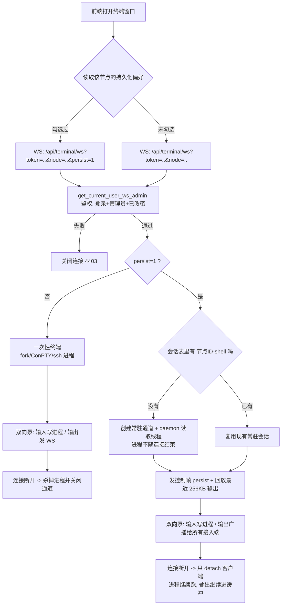
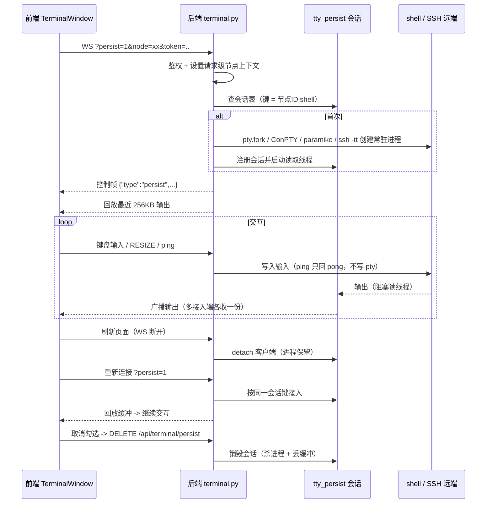

# 12 Web 终端与持久化会话

> 一台机器上「打开一个命令行」这件事，在 Graw 里要同时兼容：本机 Linux/容器、本机 Windows、
> 远程裸 SSH 节点、远程 Windows 控制端。这篇讲清楚终端连接是怎么建立、
> 断线为什么还能救回来，以及「保留持久化终端」是怎么让长任务刷不丢的。

参考源码：`backend/app/routers/terminal.py`、`backend/app/tty_persist.py`、`backend/app/routers/_wincon.py`、
`frontend/src/components/windows/TerminalWindow.vue`。

---

## 一、入口与鉴权

打开终端的方式：桌面「终端」应用、文件管理器里的「打开终端」、Docker 容器详情的「进入容器」。

前端固定做三件事（`TerminalWindow.vue`）：

1. 用 `xterm.js` 渲染终端，尺寸变化时把行列数上报后端；
2. 拼 WebSocket 地址：`/api/terminal/ws?token=<JWT>&node=<节点ID>`（容器终端走 `/api/terminal/ws/container`）；
3. 连接后先发尺寸、必要时发送工作目录 `cd` 与自动命令（`autoCommand`）。

鉴权与路由归属：

- WS 无法带 `Authorization` 头，所以令牌走**查询参数 `?token=`**，由 `get_current_user_ws_admin`
  在握手时校验：**必须登录 + 必须是管理员 + 必须已改密**（防止用终端绕过默认密码拦截）；
- `terminal` 在 `_AGENT_PROXY_EXCLUDE_PREFIX` 里 —— **终端不经过 Agent 隧道代理**，
  远程节点由主面板自己用 `paramiko` / `ssh -tt` 连过去；
- 终端属「host 类」能力：切换节点后作用在目标机器上（`remote_cap` 不拦）。

---

## 二、一个终端进程是怎么起来的

同一份上层逻辑（读写循环、心跳、尺寸同步），底层通道按平台/节点分四种：

| 场景 | 通道实现 | 说明 |
|------|----------|------|
| 本机 Linux / macOS | `pty.fork()` + `execv($SHELL)` | 容器模式下先 `chroot /host`，让终端直接操作宿主机 |
| 本机 Windows | `ConPTY`（`_wincon.py`，真伪控制台） | 输入有回显、有提示符；ConPTY 不可用时回退管道 `cmd/powershell`（无回显，体验降级） |
| 远程节点 + Windows 控制端 | `paramiko` `invoke_shell` | 复用面板已存节点密码，无需在终端里再输一次；主机密钥走 TOFU 校验（首连记录指纹，变更即拒） |
| 远程节点 + Unix 控制端 | `pty.fork()` + `ssh -tt` | `-tt` 强制分配远端伪终端；密码认证时在终端里交互输入 |

远端 `paramiko` 通道失败（未安装 / 认证失败）会自动回退到 `ssh -tt`。

**读完这条连接后，后端进入一个双向循环**：

- 输入：浏览器按键 → WS 文本帧 → 写入 pty / SSH 通道；
- 输出：后台读取线程阻塞读通道 → 经 `loop.call_soon_threadsafe` 回事件循环 → 发回浏览器；
- 尺寸：`\x1bRESIZE:rows,cols` 控制帧 → `TIOCSWINSZ` / `resize_pty` / `ResizePseudoConsole`；
- 心跳：前端每 20s 发 `{"type":"ping"}`，后端回 `{"type":"pong"}`**且不写入 pty**（否则会污染 shell 输入）。

为什么要应用层心跳？浏览器 WS 发不了协议级 ping 帧，而长时间空闲的终端会被 Nginx / NAT
静默掐断成「半开」状态（`readyState` 仍是 OPEN、`send` 也不报错），表现为「挂久了打不了字」。
前端超过 65s 没收到 pong（也没有任何真实输出）就主动断开走重连。

---

## 三、默认行为：连接断开 = 进程结束

普通终端是「连接即生命周期」：WS 一断（刷新面板、关窗口、切标签、网络抖动），
后端在 `finally` 里就 `SIGTERM` 掉子进程 / 关闭 ConPTY / 断开 SSH 通道。

对 `ls`、`vim` 这种随手操作没问题；但**正在跑的长任务（编译、大文件下载、日志跟踪、数据导入）
会随着一次刷新凭空消失** —— 这就是「保留持久化终端」要解决的问题。

---

## 四、持久化终端（保留持久化终端）

### 勾选之后发生了什么

1. 勾选框状态按**节点**写进 `localStorage`（键 `graw.terminal.persist.<节点ID>`）；
2. WebSocket 带上 `persist=1` → 后端进入 `_persistent_terminal()`；
3. 后端按**会话键 `<节点ID>|shell`** 查会话注册表（`app/tty_persist.py`）：
   - 没有 → 按当前平台/节点创建常驻通道，起一条 daemon 读取线程；
   - 已有 → 直接复用（同一节点最多一个常驻 shell，不会随刷新越开越多）；
4. 接入时后端先发**控制帧** `{"type":"persist","key":...,"fresh":...,"clients":n}`（前端只更新状态栏，
   绝不写进 xterm），随后**回放最近 256KB 输出快照**，前端收到控制帧时先 `term.reset()` 再画回放，
   避免与旧画面叠加；
5. WS 断开时只做 `detach(qid)` —— **进程继续在后台跑，输出继续进回放缓冲**。

所以「刷新面板后仍打开这一个持久化终端」是这样实现的：偏好存在 localStorage → 页面重载后组件
重新挂载并自动带上 `persist=1` → 后端按同一会话键接回原进程 + 回放历史输出。

### 多窗口共享同一个进程

一个持久会话可以有多个接入端（`clients` 计数）：输入都写进同一个 pty，输出广播给所有接入端，
行为和 `tmux attach` 的多客户端一致。前端状态栏会显示「持久终端已接入」。

### 缓冲与裁剪

回放缓冲是内存里的 256KB 环形区：超限时从头部裁剪，并把裁剪点**向后对齐到换行符**
（最多再找 4KB），避免回放以「半行」或半截 ANSI 转义序列开头导致乱码。

### 什么时候会话会结束

| 触发 | 结果 |
|------|------|
| 在终端里 `exit` / 进程崩溃 / SSH 断开 | 读取线程读到 EOF → 广播结束哨兵 → 注册表自动回收；下次连接重建新会话 |
| 用户取消勾选 | 前端调 `DELETE /api/terminal/persist?node=<ID>` → 杀掉常驻进程、丢弃缓冲 |
| 面板进程退出 / 容器重建 | `lifespan` 收尾调用 `shutdown_all()` 关闭全部会话（不留孤儿 shell） |

> 注意边界：会话只活在**面板进程内**。面板重启后会话消失——这是「进程级持久化」，
> 不是 tmux/screen 那种脱离面板的守护会话；好处是不依赖目标主机装任何工具，也不把 shell 状态落盘。

### 安全约束

- 两个 REST 端点（`GET` / `DELETE /api/terminal/persist`）都是 `ADMIN`；
- 列表只回脱敏状态（节点、创建时间、接入端数量、缓冲字节数），**不含命令输出与凭据**；
- 缓冲区纯内存，不写 `backend/data/*.json`，面板退出即消失。

---

## 五、整体流程图





---

## 六、右侧「工具」书签：多持久终端与文件管理

> 本节对应 Go 后端（`backend-go/internal/graw/handlers_terminal.go`）与前端
> `frontend/src/components/ToolDock.vue`、`ToolTerminalPane.vue`；Python 旧版无此功能。

之前的「保留持久化终端」有一个隐含限制：会话键固定是 `<节点ID>|shell`，
**一个节点只能有一个常驻 shell**，再开窗口就变成多客户端共享同一个进程（像 tmux attach）。

「工具」书签解决的是另一类需求：同时挂好几个互不干扰的长任务终端
（比如一台机器上看日志、跑编译、开数据库客户端各一个），直到手动关掉才结束。

### 用户看到的样子

1. 登录后右侧边缘出现竖排书签「工具」，点开是一个**可拖动、可收回**的浮窗；
   书签本身也能上下拖动，位置按用户名记在浏览器 `localStorage`，刷新后保持；
2. 点「+」先选工具类型（**终端 / 文件管理**），再点节点（本机 / 各 SSH 子节点）：
   终端会在那台机器上开一个持久 shell，文件管理则打开该节点的文件列表；
   标签栏用图标区分类型（终端图标用绿 / 黄表示连接状态，文件管理是文件夹图标）；
3. 浮窗可以拖到任意位置（坐标记进 localStorage），点「—」收回成右侧书签；
4. 刷新页面、切标签、收回浮窗都**不会**杀掉 shell：只是断开 WebSocket；
5. 只有点标签上的「×」并确认，才会调 `DELETE /api/terminal/persist` 结束对应进程。

### 背后的三个小改动

| 改动 | 说明 |
|------|------|
| `sid` 会话标识 | 每个终端标签由浏览器生成一个 `sid`（UUID），WS 带 `persist=1&sid=...`，后端会话键变成 `<节点ID>\|shell\|sid\|<sid>`，同一节点可并存多个常驻 shell |
| Agent 转发 | 远端 Agent 子节点会把 `sid` 原样带进桥接目标；关闭时主面板把 DELETE 经隧道转发给子节点（去掉 `node`，子节点按本机键定位） |
| 控制帧顺序 | 持久会话控制帧改用结构体序列化，保证以 `{"type":"persist"...}` 开头；否则 `encoding/json` 对 map 按字母序输出，前端识别不出控制帧，会把 JSON 画进终端 |

### Windows 本机终端：从管道模式换成 ConPTY

Go 后端原先在 Windows 上只有「管道回退」：PowerShell 用 `-Command -` 启动，约 2 秒才有输出、
没有提示符、不会逐键回显，用户看到的就是「半天没反应」。现在 `term_pty_windows.go` 通过
`github.com/UserExistsError/conpty` 接入 **ConPTY**（Win10 1809+）：

- 提示符约 1 秒出现，输入逐键回显，方向键 / Ctrl+C / TUI 与 `Resize` 都可用；
- Unix 侧仍是 `creack/pty`，两边的读写 / 改尺寸统一收敛到 `termTTY` 接口；
- ConPTY 不可用的过旧 Windows 才回退管道模式，并改用 `cmd.exe /Q`（立刻有提示符），
  不再使用响应慢的 PowerShell `-Command -`。

### 标签与进程的关系

前端**只挂载当前激活标签的 xterm**：切标签 = 旧连接断开 + 新连接接入，
后端进程与 256KB 回放缓冲始终保留，重新激活时先回放再继续。
这样即使开十几个终端，也只有一个 xterm DOM 在跑。

### 文件管理标签（轻量版）

「工具」里的文件管理不是完整版「文件管理」窗口，而是浮窗里的快捷浏览器：
路径栏（回车直达）+ 上级 / 刷新 / 上传 + 文件列表（双击目录进入、双击或点下载图标保存文件）。

- 每个文件标签**固定绑定创建时选择的节点**：请求显式带 `X-Graw-Node` 头
  （`api.js` 拦截器优先采用显式头），不跟随当前聚焦窗口的请求级节点；
  远端 Agent 节点经隧道代理，裸 SSH 节点由 hostops 远程原语执行。
- 目录存在标签描述里（localStorage），切标签 / 刷新面板后回到上次目录；
- 关闭文件标签只是移除视图，没有后端进程要结束，因此不会弹确认框。

```mermaid
flowchart TD
    A[点击右侧「工具」书签] --> B[浮窗 + 标签栏]
    B --> C{点 + 选择节点}
    C --> D["WS: /api/terminal/ws?token=..&node=..&persist=1&sid=abc"]
    D --> E{该节点已配 Agent?}
    E -- 是 --> F[桥接到子节点 WS, 转发 sid]
    E -- 否 --> G[主面板按 node|shell|sid|abc 建会话]
    F --> H[子节点按 local|shell|sid|abc 建会话]
    G --> I[记录标签到 localStorage 按用户名隔离]
    H --> I
    I --> J[切标签 / 收浮窗: 断开 WS, 进程继续跑]
    J --> K[重新激活: 同 sid 接回 + 回放输出]
    I --> L[点标签 × 并确认]
    L --> M["DELETE /api/terminal/persist?node=..&sid=.."]
    M --> N[结束该会话; Agent 节点经隧道转发]
```

### 边界与安全

- 销毁 `sid` 端点仍是 `terminal` 模块权限；`sid` 有正则白名单（字母/数字/`_`/`-`，≤64 位），
  Agent 桥接时也只透传这个受校验的参数；
- 会话依旧只活在**面板进程内**：面板重启后 `sid` 对应的进程消失，前端用同一个 `sid` 重连会
  得到一个新的 shell（标签结构保留）；
- 标签列表按用户名隔离存在浏览器 localStorage，**不含任何命令输出**；
- 终端 WS 仍强制管理员 + 已改默认密码 + `terminal` 权限，与其他终端入口一致。

---

## 七、关键文件

| 文件 | 职责 |
|------|------|
| `backend/app/routers/terminal.py` | 终端 WS（一次性 + 持久两种模式）、四种底层通道工厂、`GET/DELETE /api/terminal/persist` |
| `backend/app/tty_persist.py` | 持久会话本体：回放缓冲、多客户端广播、读取线程、会话注册表 |
| `backend/app/routers/_wincon.py` | Windows ConPTY 封装（真伪控制台） |
| `backend/app/main.py` | `lifespan` 启动/收尾：面板退出时 `shutdown_all()` 关闭持久会话 |
| `frontend/src/components/windows/TerminalWindow.vue` | xterm 渲染、勾选框、控制帧处理、断线重连与偏好持久化 |
| `backend-go/internal/graw/handlers_terminal.go` | Go 后端终端：WS（一次性 / 持久 / 多 `sid` 持久）、会话注册表、`GET/DELETE /api/terminal/persist` |
| `backend-go/internal/graw/term_pty_windows.go` / `term_pty_unix.go` | 本地终端通道：Windows ConPTY（提示符 / 回显 / resize）与 Unix PTY，统一实现 `termTTY` 接口 |
| `frontend/src/components/ToolDock.vue` | 右侧「工具」书签、可拖动 / 收回浮窗、节点选择、多终端标签与关闭 |
| `frontend/src/components/ToolTerminalPane.vue` | 浮窗内的单个持久终端（`persist=1&sid=...`、心跳、重连、右键复制粘贴） |

---

## 更新记录

- 2026-11-28：
  - 新增右侧「工具」书签与多持久终端浮窗：每个终端带独立 `sid`，会话键为
    `<节点ID>|shell|sid|<sid>`，同一节点可并存多个常驻 shell，直到手动关闭；
  - `DELETE /api/terminal/persist` 支持 `sid`（只关单个终端），Agent 子节点的创建 / 关闭
    均经隧道转发 `sid`；
  - 修正持久会话控制帧的 JSON 字段顺序（结构体序列化），确保以 `{"type":"persist"...}`
    开头，前端能正确识别、不再把控制帧画进终端；
  - Windows 本机终端改用 ConPTY（`term_pty_windows.go`），提示符 / 逐键回显 / 方向键 /
    Ctrl+C / 尺寸同步恢复正常；ConPTY 不可用的旧系统回退 `cmd.exe /Q`；
  - 右侧「工具」书签支持上下拖动，位置按用户名存 `localStorage` 并在刷新后恢复；
  - 「工具」浮窗新增文件管理标签：先选工具类型再选节点，文件列表固定绑定节点
    （显式 `X-Graw-Node`），支持浏览 / 上传 / 下载，目录随标签持久化；
    标签图标改为终端 / 文件夹图标（终端图标兼作连接状态指示）。
- 2026-09-25：
  - 新增「保留持久化终端」：勾选后 shell 进程常驻后端，刷新面板 / 重开窗口按
    `<节点ID>|shell` 会话键接回同一终端并回放最近 256KB 输出；支持多窗口共享同一常驻进程；
  - 新增 `GET/DELETE /api/terminal/persist`（`ADMIN`）用于查询与结束常驻会话；
  - 面板退出时通过 `lifespan` 调用 `tty_persist.shutdown_all()` 结束全部常驻会话，避免孤儿进程；
  - 前端按节点把勾选偏好写入 `localStorage`，实现「刷新后自动接回」。