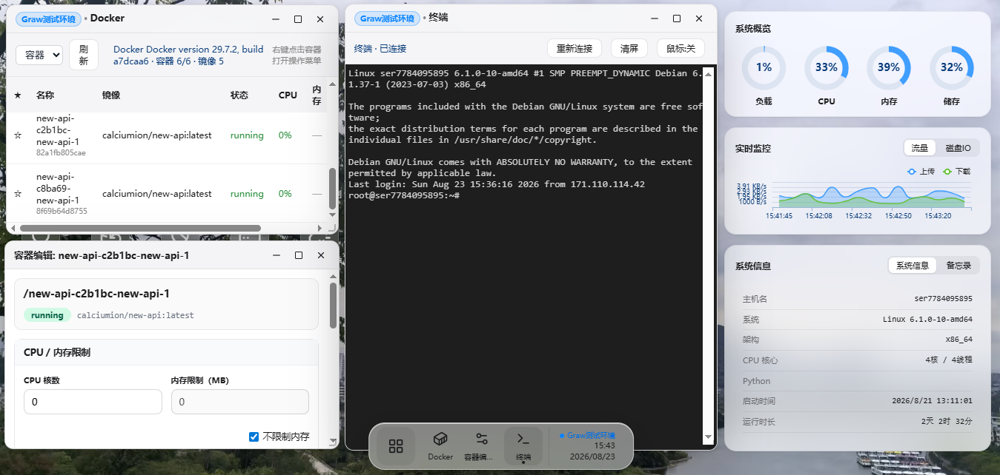
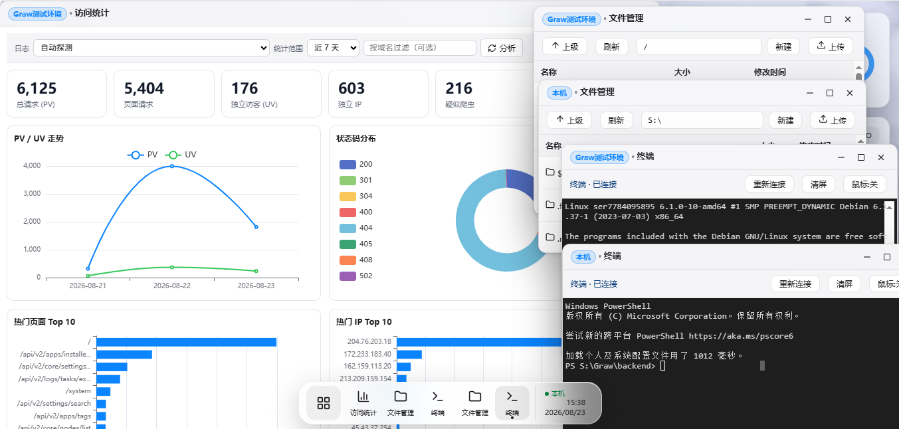
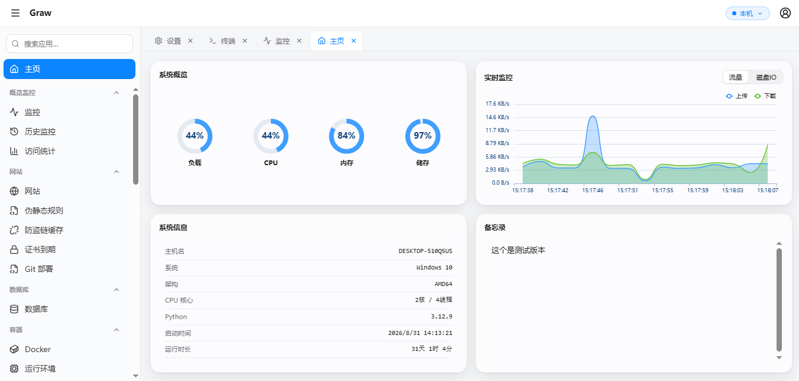

# Graw

一个基于 Web 的服务器管理面板，采用「类桌面操作系统」的交互设计（窗口、任务栏、桌面快捷方式），并内置一套经典侧边栏风格的标准面板模式。前端使用 Vue 3 + Vite，后端使用 Go（`backend-go/`）。

除本机外，Graw 还能通过 **Agent 隧道 + 成对访问密钥** 把其它主机作为「子节点」纳入统一面板管理：在一处即可切换主机，管理多台服务器的容器、网站、文件、终端与防火墙。

**English** — Graw is an open-source, self-hosted **server management panel** with a desktop-like UI: a modern alternative to Cockpit. Real-time monitoring, Docker & App Store, websites, databases, web terminal and multi-node management — all in one panel, built with Vue 3 + Go and deployable with one Docker command.

<p align="center">
  <a href="https://github.com/wuhulab/Graw/stargazers"></a>
  <a href="https://github.com/wuhulab/Graw/tags"></a>
  <a href="https://hub.docker.com/r/shunx/graw"></a>
  <a href="./LICENSE"></a>
  <a href="https://github.com/wuhulab/Graw/issues"></a>
  <a href="https://github.com/wuhulab/Graw/commits/main"></a>
</p>

<p align="center">
  
</p>

### 多语言 README

[简体中文](./README.md) ·
[繁體中文](./readme-i18n/README.zh-TW.md) ·
[English](./readme-i18n/README.en.md) ·
[日本語](./readme-i18n/README.ja.md) ·
[한국어](./readme-i18n/README.ko.md) ·
[Русский](./readme-i18n/README.ru.md) ·
[Español](./readme-i18n/README.es.md) ·
[Français](./readme-i18n/README.fr.md) ·
[Deutsch](./readme-i18n/README.de.md) ·
[Português](./readme-i18n/README.pt.md) ·
[Esperanto](./readme-i18n/README.eo.md)


## 相关链接

| 项目 | 地址 |
|------|------|
| 源码仓库 | <https://github.com/wuhulab/Graw> |
| 应用商店配方 | <https://github.com/wuhulab/Graw-app-store> |
| Docker 镜像 | <https://hub.docker.com/r/shunx/graw> |
| 官网 | <https://graw.shunx.top/> |
| 问题反馈 | <https://github.com/wuhulab/Graw/issues/new/choose> |
| 捐赠支持 | <https://afdian.com/a/shunianssy> |

## 界面预览

同一套功能，两种外壳：**类桌面模式**（窗口 / 任务栏 / 桌面快捷方式）与 **经典侧边栏风格的标准面板模式**，在设置中随时切换。

**类桌面模式** —— 多窗口工作区，访问统计、文件管理、终端等应用并行操作：

<p align="center">
  
</p>

**标准面板模式** —— 侧边栏分组菜单 + 多标签页，熟悉传统面板的用户零成本上手：

<p align="center">
  
</p>

## 怎么下载？

Graw 以容器方式运行，但它的**所有管理操作（Docker 容器/镜像、应用商店安装、Web 终端、进程/防火墙、网站配置等）都要作用于宿主机**。因此**不能**只写 `-p 端口:8000` 那样裸起容器，必须按下述「完整宿主机模式」启动：让容器能访问宿主机 Docker（socket）、宿主机根目录（`/host`），并具备宿主级权限（`privileged` + `pid host`）。

**方式一：Linux 服务器（推荐，使用 host 网络直接监听宿主机 8000 端口）**

```bash
docker run -d --name graw-panel \
  --network host --pid host --privileged \
  -v /opt/graw/data:/app/backend/data \
  -v /:/host:rslave \
  -v /var/run/docker.sock:/var/run/docker.sock \
  -e HOST_ROOT=/host \
  -e GRAW_HOST_DATA=/opt/graw/data \
  -e TZ=Asia/Shanghai \
  shunx/graw:latest
```

启动后访问 `http://<服务器IP>:8000`。

**方式二：Bridge 网络（自定义访问端口，例如 8041）**

```bash
docker run -d --name graw-panel \
  -p 8041:8000 --pid host --privileged \
  -v /opt/graw/data:/app/backend/data \
  -v /:/host:rslave \
  -v /var/run/docker.sock:/var/run/docker.sock \
  -e HOST_ROOT=/host \
  -e GRAW_HOST_DATA=/opt/graw/data \
  -e TZ=Asia/Shanghai \
  shunx/graw:latest
```

启动后访问 `http://<服务器IP>:8041`。

**方式三：Docker Compose（仓库内已提供高权限编排）**

```bash
git clone https://github.com/wuhulab/Graw.git
cd Graw
docker compose up -d --build
```

各参数含义（面板完整管理宿主机所必需）：

- `--privileged`：授予容器全部内核能力，否则 `chroot /host`、iptables/防火墙、挂载等操作无法在容器内生效。
- `--pid host`：共享宿主机进程命名空间，进程管理/系统监控才能看到宿主机全部进程。
- `--network host`：使用宿主机网络，面板直接监听宿主机 8000 端口（方式二改用 `-p 端口映射`）。
- `-v /:/host:rslave` + `HOST_ROOT=/host`：把宿主机根目录挂进容器 `/host`，面板经 `chroot /host` 操作宿主机文件与命令（nginx/certbot/crontab 等）。
- `-v /var/run/docker.sock:/var/run/docker.sock`：对接宿主机 Docker 引擎（容器/镜像/日志管理）。
- `/opt/graw/data` 为面板数据目录（绑定到宿主）；`GRAW_HOST_DATA=/opt/graw/data` 告知宿主机 docker-compose 文件所在，Docker 应用商店才能完成安装。

> **安全警告**：上述容器实质拥有宿主机 root 级操作能力，仅建议部署于可信环境。请在首次登录后**立即修改默认密码**，并妥善保护 `backend/data/` 下的凭据文件。

## 功能特性

- **账号与权限系统** —— 基于 JWT 的用户登录、角色（管理员/普通用户）、账号管理、强制改密、登录日志、在线会话管理（按 token 有效期与最后活跃时间判定在线）
- **双界面形态** —— 类桌面模式（窗口/任务栏/桌面快捷方式，支持拖拽、最大化/最小化）与经典侧边栏风格的标准面板模式（分组菜单 + 多标签）
- **多节点管理** —— 主面板通过 Agent 隧道 + 成对访问密钥纳管子节点，支持 SSH 密钥部署、请求级主机切换与远端子节点能力门控
- **实时系统监控** —— CPU、内存、磁盘、网络、负载，通过 WebSocket 实时推送数据与图表，支持历史指标查询
- **网站管理** —— Nginx / OpenResty / Apache 虚拟主站增删改查、启停、配置生成与查看；可与现成的 OpenResty 环境共存并自动发现外部站点
- **WAF 与网站增强** —— Web 应用防火墙、伪静态/rewrite、缓存与站点增强配置、站点统计
- **数据库管理** —— MySQL / MariaDB / Redis / PostgreSQL / MongoDB 连接管理、库表浏览、SQL / Redis 命令执行、慢查询分析
- **Docker 管理** —— 容器与镜像的查看、启动、停止、日志、资源统计，兼容 docker 与 podman 输出格式
- **应用商店** —— 基于 YAML 配方一键安装应用（安装即 `docker compose`），支持自定义 compose 编辑与安装日志
- **文件管理** —— 浏览目录、上传下载、权限修改、压缩解压、复制重命名；Windows 风格剪贴板（Ctrl+C/V/Delete）与拖拽文件夹上传
- **回收站** —— 误删文件进入回收站，支持还原与按天自动清理（跨节点）
- **Web 终端** —— 基于 xterm.js 的浏览器内终端，直接操作服务器（WebSocket 通过 `?token=` 鉴权）
- **计划任务 / 防火墙 / SSL** —— Cron 表达式管理（crontab / schtasks）、端口与 IP 黑白名单（iptables / netsh，含 Docker 发布端口出入站管控）、证书上传与 Let's Encrypt 申请
- **安全与运维** —— ShunX 安全入口、网页防篡改（WS 实时告警）、防火墙规则统一、健康体检、面板备份、服务监控、证书到期检测、通知中心
- **其它** —— 日志中心、进程管理、备忘录、内网穿透（Frp）、网络储存、FTP 用户、PHP 版本管理、工具箱、插件开放协议（GPOP）

## 技术栈

| 层级 | 技术 |
|------|------|
| 前端 | Vue 3（Composition API）、Vite 5、Axios、ECharts / vue-echarts、xterm.js、vue-i18n |
| 后端 | Go 1.23（`backend-go/`，标准库 HTTP + gorilla/websocket + gopsutil）；`backend/` 为 Python/FastAPI 旧版实现，接口与数据格式兼容 |
| 通信 | REST API（`/api/*`）+ WebSocket（监控流、终端） |
| 部署 | 多阶段 Docker 构建（前端 Node 构建 → Go 交叉编译 → Alpine 运行时） |

## 目录结构

```
Graw/
├── frontend/                 # Vue 3 前端
│   ├── src/
│   │   ├── components/       # 桌面、窗口、任务栏、卡片组件
│   │   │   └── windows/      # 每个功能一个独立窗口组件（*Window.vue）
│   │   ├── store/            # reactive 单例状态（auth / systemMetrics / docker ...）
│   │   ├── locales/          # vue-i18n 多语言（共 22 种）
│   │   └── App.vue           # 根组件（桌面环境 / 面板模式切换）
│   ├── vite.config.js        # 开发代理 /api(含 ws) → :8000
│   └── package.json
├── backend-go/               # Go 1.23 后端（默认，接口/数据兼容 Python 版）
│   ├── main.go               # 进程入口：配置、播种账号、后台协程、HTTP 服务
│   ├── internal/graw/        # 路由、鉴权、SSH/Agent、中间件与各业务模块
│   └── Dockerfile            # 前端构建 + Go 编译 + 精简运行时
├── backend/                  # Python/FastAPI 旧版后端（保留兼容与回归测试）
│   ├── app/
│   │   ├── main.py           # 应用入口：路由注册、中间件、lifespan 后台任务
│   │   ├── auth.py           # JWT 鉴权依赖与用户播种
│   │   ├── agent_*.py        # 子节点 Agent 鉴权 / 配置 / 隧道代理
│   │   ├── node_manager.py   # 多节点上下文与请求级主机切换
│   │   ├── hostfs.py         # 宿主机文件系统适配层（chroot /host）
│   │   ├── routers/          # 各业务模块路由
│   │   └── data/             # 运行时数据（gitignore，权限收紧）
│   ├── test_*_unit.py        # pytest 单元测试（test_*_e2e.py 为端到端用例）
│   └── requirements.txt
├── app-store/                # 社区应用商店 YAML 配方与图标
├── plugin-examples/          # 插件开放协议（GPOP）示例
├── readme-i18n/              # 多语言 README（10 个语种）
├── docs/                     # 开发者/运维文档（文档中心见 docs/README.md）
├── GETMEREAD/                # 「大白话 + Mermaid」运行逻辑文档
├── agent/skills/             # 项目内技能（hop / secreview）
├── Dockerfile                # 多阶段构建（前端构建 → Go 编译 → 运行时）
├── docker-compose.yml        # 「完整管理宿主机」高权限编排
├── start.sh / start.bat      # 本地开发一键启动（Go 后端 + 前端）
└── AGENTS.md                 # 代码库架构与开发约定（改代码前必读）
```

## 快速开始

### 环境要求

- Go 1.23+
- Node.js 16+
- （可选）Docker 引擎，用于 Docker 管理功能

### 一键启动（开发）

```bash
# Linux / macOS
./start.sh

# Windows
start.bat
```

脚本会在需要时下载 Go 模块、安装前端依赖，并同时拉起 Go 后端与前端。

### 手动启动

**1. 启动后端（Go）**

```bash
cd backend-go
go mod download                  # 首次拉取依赖；网络受限可先设置 GOPROXY
go run .                         # 默认监听 :8000
```

**2. 启动前端**

```bash
cd frontend
npm install
npm run dev                      # → http://localhost:5173，Vite 代理 /api 与 ws 到 :8000
```

> Windows 的 PowerShell/cmd 不支持 `&&`，多命令请用分号 `;` 分隔。

### 后端说明（Go 默认）

`backend-go/` 是当前默认后端：接口路径、响应结构、`data/` 数据文件格式与 Python 旧版（`backend/`）保持兼容，前端无需任何改动。

**可选运行依赖**

- Docker / Podman CLI：Docker 管理、应用商店安装、运行环境等功能需要
- `certbot`、`crontab`、`smbclient`/`mc` 等：按需用于证书、计划任务、网络存储、S3 备份

启动后访问 `http://localhost:8000`。若 Go 与 Python 旧版需要同时运行，用 `GRAW_ADDR` 换端口：

```bash
# Linux / macOS
GRAW_ADDR=:8001 ./graw-go

# Windows PowerShell
$env:GRAW_ADDR = ":8001"
.\graw-go.exe
```

**数据目录**

未设置 `GRAW_DATA_DIR` 时，Go 版会优先复用 `backend/data`（从 `backend-go/` 目录运行时读取 `../backend/data`），因此可直接沿用 Python 版的账号、节点、密钥等数据；没有该目录时使用 `backend-go/data`。需要独立数据时：

```bash
# Linux / macOS
GRAW_DATA_DIR=/opt/graw/data GRAW_ADDR=:8001 ./graw-go

# Windows PowerShell
$env:GRAW_DATA_DIR = "C:\GrawData"
$env:GRAW_ADDR = ":8001"
.\graw-go.exe
```

**常用环境变量**

| 变量 | 说明 | 默认值 |
|------|------|--------|
| `GRAW_ADDR` | HTTP 监听地址 | `:8000` |
| `GRAW_DATA_DIR` | 数据目录（users.json / nodes.json / secret.key 等） | `../backend/data` 或 `data` |
| `GRAW_FRONTEND_DIST` | 前端构建产物目录；存在时由后端同源托管 | 自动探测 `frontend/dist` |
| `HOST_ROOT` | 容器部署时的宿主机根目录挂载点（如 `/host`） | 空（本机直跑） |
| `GRAW_HOST_DATA` | 面板 `data` 目录在宿主机上的实际路径（宿主 Docker 读取 compose/备份用） | 空 |
| `GRAW_DOCKER_BIN` | 指定 docker/podman CLI 路径 | 自动探测 |
| `GRAW_APP_STORE_DIR` | 本地应用商店目录（`index.json`、`apps/`） | 自动探测 `app-store/` |
| `GRAW_MAX_BODY_MB` / `GRAW_MAX_UPLOAD_MB` | 普通请求体 / multipart 上传大小上限（MB） | `16` / `2048` |
| `GRAW_APPSTORE_ALLOW_PRIVATE_NET` | 设为 `1` 时允许应用商店索引指向内网地址 | 空（仅公网） |
| `GRAW_RUNTIME_MOUNT_DENY` | 追加禁止作为运行环境容器挂载源的路径（逗号分隔） | 空 |

> 容器化部署时，`HOST_ROOT`、`GRAW_HOST_DATA` 与高权限参数的含义与 Python 版一致，参见 [docs/deployment.md](./docs/deployment.md)。

**生产运行（单二进制 + 前端静态资源）**

```bash
# 1. 构建前端（仓库根目录）
cd frontend
npm install
npm run build

# 2. 编译 Go 后端（静态二进制）
cd ../backend-go
CGO_ENABLED=0 go build -trimpath -ldflags "-s -w" -o graw-go .

# 3. 启动（自动托管 ../frontend/dist）
./graw-go
```

也可以直接构建镜像（仓库根 `Dockerfile` 即 Go 版；`backend-go/Dockerfile` 内容等价）：

```bash
docker build -t shunx/graw .
# 或
docker build -f backend-go/Dockerfile -t shunx/graw .
```

> 首次启动会向数据目录播种 `admin / admin123` 账号（首次登录强制改密）。

**离线重置密码（忘记密码）**

Go 版提供与 `backend/reset_password.py` 等价的离线重置命令，直接读写 `data/users.json`，无需启动面板：

```bash
cd backend-go

# 交互式：先列出账号，再输入账号与新密码（密码输入不回显）
go run ./cmd/reset-password

# 指定账号
go run ./cmd/reset-password admin

# 仅列出账号（含角色与「待改密」标记）
go run ./cmd/reset-password -l

# 或编译为独立工具
go build -o reset-password ./cmd/reset-password
./reset-password admin                 # Windows: .\reset-password.exe admin
```

- 密码至少 6 个字符，需二次确认；重置后清除「强制改密」标记，可立即用新密码登录。
- 数据目录解析规则与面板一致：优先 `GRAW_DATA_DIR`，否则复用 `../backend/data`；使用独立数据目录时先设置该变量，例如 `GRAW_DATA_DIR=/opt/graw/data ./reset-password admin`。
- 重置不会强制下线已登录会话。

### 生产构建

前端生产构建输出到 `frontend/dist`，Go 后端会自动检测并挂载该目录作为静态资源：

```bash
cd frontend
npm run build

cd ../backend-go
CGO_ENABLED=0 go build -trimpath -ldflags "-s -w" -o graw-go .
./graw-go                        # 默认监听 :8000，自动托管 ../frontend/dist
```

也可以通过 `./graw.sh start`（Windows 为 `graw.bat start`）一键构建并以后台守护进程运行。容器部署直接使用仓库内的 `Dockerfile` / `docker-compose.yml`。

## API 概览

所有接口以 `/api/*` 为前缀，除 `/api/auth/login` 与 `/api/health` 外均要求 `Authorization: Bearer <token>` 头。

| 模块 | 前缀 | 说明 |
|------|------|------|
| Auth | `/api/auth` | 登录、当前用户、改密、用户管理（管理员） |
| Agent | `/api/agent` | 子节点机器间鉴权（成对密钥换取 JWT） |
| System | `/api/system` | CPU、内存、磁盘、网络、负载、WebSocket 实时流 |
| Nodes | `/api/nodes` | 多节点管理与当前管理主机切换 |
| Sites | `/api/sites` | 网站虚拟主机管理（Nginx / OpenResty / Apache） |
| WAF | `/api/waf` | Web 应用防火墙规则与站点防护 |
| Databases | `/api/databases` | MySQL / MariaDB / Redis / PostgreSQL / MongoDB 连接与查询 |
| Docker | `/api/docker` | 容器、镜像、卷与容器编辑 |
| Files | `/api/files` | 文件浏览、传输、权限、压缩解压 |
| Recycle | `/api/recycle` | 回收站（还原、自动清理） |
| Terminal | `/api/terminal` | WebSocket 终端会话（通过 `?token=` 鉴权） |
| App Store | `/api/appstore` | 应用商店配方安装与管理 |
| Cron / Firewall / SSL | `/api/cron`、`/api/firewall`、`/api/ssl` | 计划任务 / 防火墙 / 证书 |
| 运维与安全工具 | `/api/protection`、`/api/portforward`、`/api/report`、`/api/rollback`、`/api/imgsafety`、`/api/slowquery`、`/api/batch`、`/api/gitdeploy` | 防护中心 / SSH 端口转发 / 巡检报告 / 配置快照回滚 / 镜像漏洞扫描 / 慢查询 / 批量操作 / 站点 Git 部署 |
| Plugins | `/api/plugins`、`/api/op` | 插件管理与插件开放接口（GPOP） |

完整路由清单与鉴权分级（`PROTECTED` / `ADMIN` / 端点内自鉴权）见 [AGENTS.md](./AGENTS.md) 第 3 节。接口文档默认关闭，调试时设置环境变量 `GRAW_ENABLE_DOCS=1` 后访问 `/docs`。

## 默认账号

首次启动后会在 `backend/data/users.json` 中自动播种：

- 账号：`admin`
- 密码：`admin123`
- 状态：首次登录后强制改密

签名密钥持久化在 `backend/data/secret.key`（首次启动自动生成）。请在生产环境中妥善保管该文件及 `users.json`，并修改默认密码。

## 重置密码

如果忘记管理员密码或无法登录 Web 面板，可以在服务器本地直接运行命令行工具重置密码（无需启动后端服务）：

```bash
cd backend-go

# 列出所有账号
go run ./cmd/reset-password -l

# 重置指定账号（交互式输入新密码）
go run ./cmd/reset-password admin

# 不指定账号，工具会提示选择
go run ./cmd/reset-password
```

工具直接读写 `backend/data/users.json`，密码输入会隐藏，重置后自动清除「首次登录必须改密」标志。新密码至少 6 位。Python 旧版的等价命令为 `cd backend && python reset_password.py admin`。

## 配置

前端开发服务器的代理配置位于 `frontend/vite.config.js`，默认将 `/api` 与 WebSocket 转发到 `http://localhost:8000`：

```js
server: {
  proxy: {
    '/api': {
      target: 'http://localhost:8000',
      changeOrigin: true,
      ws: true
    }
  }
}
```

常用的环境变量：

| 变量 | 说明 |
|------|------|
| `HOST_ROOT` | 宿主机根目录在容器内的挂载点（如 `/host`），启用宿主机模式 |
| `GRAW_HOST_DATA` | 面板 `data` 目录在宿主机上的实际路径，应用商店安装所需 |
| `GRAW_ENABLE_DOCS` | 设为 `1` 时开放 `/docs`、`/redoc`、`/openapi.json` |
| `GRAW_SESSION_ONLINE_SECONDS` | 会话在线判定空闲阈值（秒），默认 2 小时 |
| `GRAW_MAX_BODY_MB` / `GRAW_MAX_UPLOAD_MB` | 普通请求体 / 文件上传大小上限（MB），默认 16 / 2048 |
| `TZ` | 容器时区，如 `Asia/Shanghai` |

完整环境变量（含 `GRAW_AGENT_*`、`TRUSTED_PROXY_DEPTH` 等）见 [docs/deployment.md](./docs/deployment.md)。

## 项目文档

- [docs/README.md](./docs/README.md) —— **文档中心**：全部文档的定位与建议阅读顺序
- [AGENTS.md](./AGENTS.md) —— 架构、约定与常见陷阱（**改动代码前请先通读**）
- [CONTRIBUTING.md](./CONTRIBUTING.md) —— 贡献指南与贡献者许可协议（CLA）
- [SECURITY.md](./SECURITY.md) —— 安全问题报告流程
- [CHANGELOG.md](./CHANGELOG.md) —— 版本变更记录
- [GETMEREAD/](./GETMEREAD/) —— 「大白话 + 流程图」讲清各模块怎么跑起来的
- [docs/deployment.md](./docs/deployment.md) —— 部署与运维（启动方式、环境变量、数据目录、排障）
- [docs/node-agent.md](./docs/node-agent.md) —— 子节点 Agent 部署与接入实操
- [docs/api-overview.md](./docs/api-overview.md) —— API 概览与鉴权模型
- [docs/plugin-protocol.md](./docs/plugin-protocol.md) —— 插件开放协议（GPOP）
- [docs/app-store-recipe.md](./docs/app-store-recipe.md) —— 应用商店机制与配方要点
- [app-store/](./app-store/) —— 应用商店配方（YAML）字段规范
- [plugin-examples/](./plugin-examples/) —— 插件示例


## 问题反馈

遇到问题请按以下顺序处理，通常能最快得到答案：

1. **先查文档** —— [文档中心](./docs/README.md)（部署、子节点 Agent、插件协议、应用商店等）与 [部署与运维文档](./docs/deployment.md)（启动失败、环境变量、数据目录与排障）；官网 <https://graw.shunx.top/> 提供安装说明与界面预览。
2. **再搜已有 Issue** —— 在 [Issues](https://github.com/wuhulab/Graw/issues)（含已关闭）中搜索关键词，常见问题大多已有现成答案。
3. **无法登录面板** —— 在服务器本地运行 `cd backend-go && go run ./cmd/reset-password admin` 即可离线重置管理员密码，详见 [重置密码](#重置密码)。
4. **提交问题请走模板** —— 按模板填写 Graw 版本、部署方式与环境信息（日志请先脱敏），便于快速定位：
   - [Bug 反馈](https://github.com/wuhulab/Graw/issues/new?template=bug_report.yml)
   - [功能建议](https://github.com/wuhulab/Graw/issues/new?template=feature_request.yml)
   - [使用求助](https://github.com/wuhulab/Graw/issues/new?template=question.yml)
5. **安全漏洞** —— 请使用 [私有漏洞报告](https://github.com/wuhulab/Graw/security/advisories/new)，勿在公开 Issue 中张贴。

## 贡献

欢迎提交 Issue 或 Pull Request，详见 [CONTRIBUTING.md](./CONTRIBUTING.md)。

> **贡献者许可协议（CLA）**：向本项目提交代码、文档或其它内容，即表示你**默认同意** [CLA](./CONTRIBUTING.md#7-贡献者许可协议cla)，包括授权 **WuHuLaB** 保留将其贡献用于**商业用途**及以**闭源（专有）许可**再许可/分发的权利。

## 捐赠

如果 Graw 对你有帮助，欢迎请作者喝杯咖啡 ☕

- 爱发电：<https://afdian.com/a/shunianssy>
- 雨云（赞助商，便宜服务器）：<https://www.rainyun.com/NjQwNjg5_>
- 也可以点击仓库页右上角的 **Sponsor** 按钮（由仓库根目录的 `FUNDING.yml` 提供）。

## License

本项目以 [AGPLv3](./LICENSE) 开源发布。

根据 [贡献者许可协议（CLA）](./CONTRIBUTING.md#7-贡献者许可协议cla)，WuHuLaB 保留将本项目（含社区贡献）用于**商业用途**并按**闭源（专有）许可**再许可或分发的权利。
